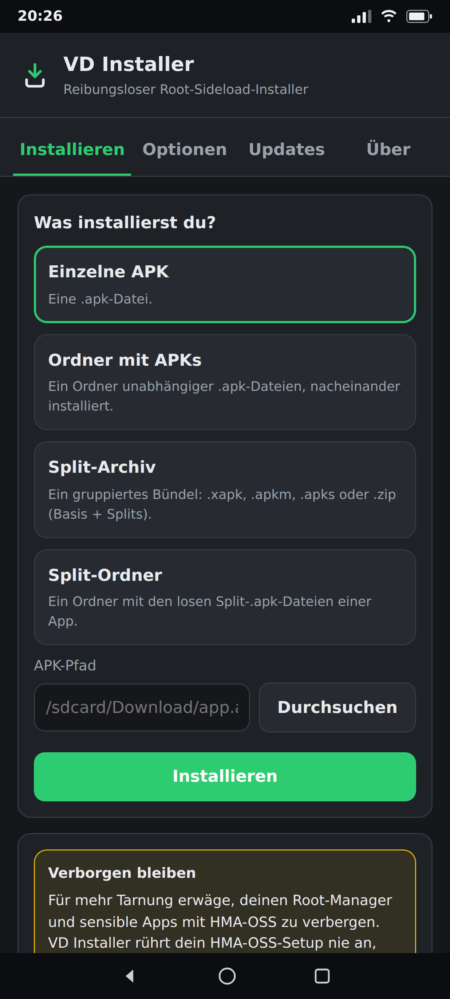
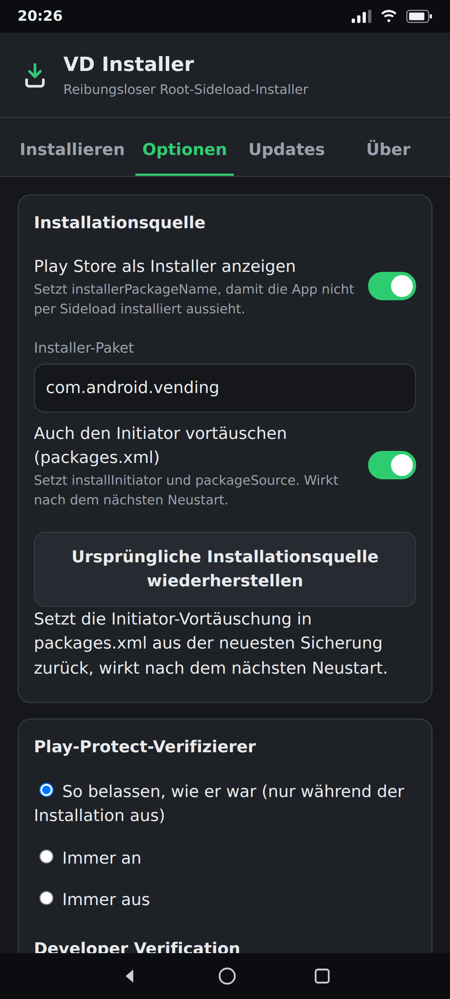
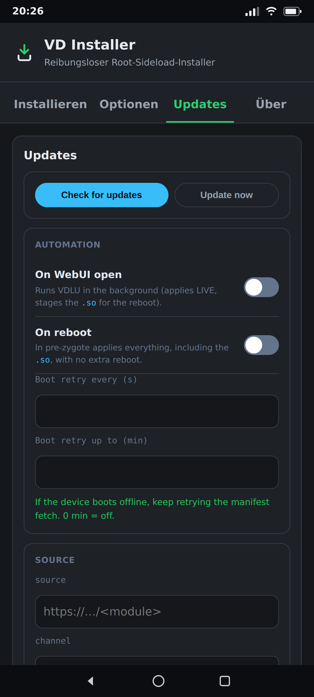
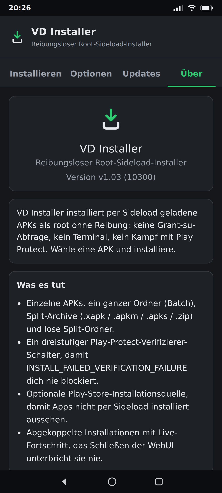

<!--
  ======================================================================
   VD INSTALLER  ::  frictionless root sideload installer
   Install sideload APKs as root (single/batch/split), no friction: KernelSU/APatch/Magisk WebUI.

   Copyright (C) 2026  VD171
   SPDX-License-Identifier: AGPL-3.0-or-later

   Free software under the GNU AGPL v3 or later. NETWORK COPYLEFT: run a
   modified version, even as a service, and you MUST offer its source.

   Site           : https://vd171.ru
   Site           : https://vd.priv8.ru
   Source         : https://github.com/VD171/VD-Installer
   GitHub         : @VD171 https://github.com/VD171
   XDA-Developers : @VD171 https://xdaforums.com/m/vd171.4699873/
   XDA thread     : https://xdaforums.com/t/VD-Installer.4809504/
   Telegram       : @VD_Priv8 https://t.me/VD_Priv8
   Channel        : @Priv8_VD https://t.me/Priv8_VD
   Discord        : @VD.Priv8 https://discord.com/users/1296831918989639721
   E-mail         : vd.priv8@pm.me
  ======================================================================
-->

> **Languages:** [English](README.md) · [العربية](README.ar.md) · [Čeština](README.cs.md) · Deutsch · [Español](README.es.md) · [فارسی](README.fa.md) · [Français](README.fr.md) · [हिन्दी](README.hi.md) · [Bahasa Indonesia](README.id.md) · [Italiano](README.it.md) · [日本語](README.ja.md) · [한국어](README.ko.md) · [Nederlands](README.nl.md) · [Polski](README.pl.md) · [Português](README.pt.md) · [Русский](README.ru.md) · [Svenska](README.sv.md) · [ไทย](README.th.md) · [Türkçe](README.tr.md) · [Українська](README.uk.md) · [Tiếng Việt](README.vi.md) · [中文](README.zh.md)

  

  
  
  
  

  <a href="https://github.com/VD171/VD-Installer/releases">Releases</a> ·
  <a href="https://github.com/VD171/VD-Installer/wiki">Wiki</a> ·
  <a href="https://github.com/VD171/VD-Installer/wiki/USER-GUIDE">Benutzerhandbuch</a> ·
  <a href="https://github.com/VD171/VD-Installer/wiki/AI-AGENTS">KI-Agenten</a> ·
  <a href="https://github.com/VD171/VD-Installer/wiki/ARCHITECTURE">Architektur</a> ·
  <a href="https://github.com/VD171/VD-Installer/wiki/FILE-STRUCTURE">Dateistruktur</a> ·
  <a href="https://github.com/VD171/VD-Installer/wiki/BINARIES">Binaries</a> ·
  <a href="CHANGELOG.md">Änderungsprotokoll</a> ·
  <a href="https://xdaforums.com/t/VD-Installer.4809504/">XDA thread</a>

# VD Installer

> Reibungsloser Root-Sideload-Installer: KernelSU / APatch / Magisk WebUI.

## Screenshots

     

## Warum

Eine per Sideload installierte APK auf einem gerooteten Telefon zu installieren ist umständlicher,
als es sein müsste: Der Paket-Verifizierer von Play Protect kann
`INSTALL_FAILED_VERIFICATION_FAILURE` auslösen, Split-Apps (`.xapk` / `.apkm` / `.apks`) brauchen die
Session-API von Hand, und eine frisch installierte App gibt sich gegenüber jeder App, die ihre
Installationsquelle ausliest, als "per Sideload installiert" zu erkennen. VDInstaller erledigt das
alles für dich, bereits als root, ohne "su gewähren"-Abfrage und ohne Terminal.

## Funktionen

- **Jede Form von APK:** eine einzelne `.apk`, ein ganzer Ordner unabhängiger APKs (Batch), ein
  gruppiertes Split-Archiv (`.xapk` / `.apkm` / `.apks` / `.zip`) oder ein Ordner loser Split-APKs.
- **Keine Verifizierungs-Mauer:** ein 3-fach-Schalter für den Paket-Verifizierer von Play Protect:
  so belassen, wie er war (nur während der Installation aus, exakt wiederhergestellt), immer an oder
  immer aus.
- **Ehrlich zur Developer Verification:** eine Root-Installation ist von Androids Developer
  Verification 2026 ohnehin ausgenommen, der Schalter ist Best-Effort und sagt das auch, nie ein
  Scheinschalter.
- **Nicht "per Sideload installiert":** stellt die Installationsquelle optional als Play Store dar,
  sowohl den Installer (zum Installationszeitpunkt) als auch den Initiator (über eine ABX-bewusste
  `packages.xml`-Bearbeitung).
- **Abgekoppelt und fortsetzbar:** Installationen laufen als abgekoppelter Root-Prozess, das
  Schließen der WebUI unterbricht sie nie, und die UI klinkt sich über die Operations-ID wieder ein.
- **Deine Entscheidung:** Test-Pakete, alle Laufzeitberechtigungen gewähren, Zielnutzer,
  Umgehung der Sperre für niedriges Target-SDK: alles optional.
- **Offline, eigenständig, ohne Neustart:** ein WebUI-Modul mit gebündelten Binaries, nutzbar in dem
  Moment, in dem es geflasht wird.

## KI-Agenten

Dieses Projekt begrüßt KI- und Agenten-Beiträge. Die Engine spricht JSON über einen kleinen
Headless-Vertrag (`scripts/helper.sh <verb> <base64(JSON)>`), dokumentiert in
[docs/AI-AGENTS.md](docs/AI-AGENTS.md), sodass ein Agent jede Aktion ansteuern kann, die auch die
WebUI kann, die WebUI bitte nicht scrapen. Patches von KI unterliegen derselben Review-Latte wie
alle anderen.

## Installation

Flashe die Zip in KernelSU, APatch oder Magisk und öffne die VDInstaller-WebUI aus deinem
Root-Manager. Der Installer behält nur die ABI deines Geräts und führt die obligatorische
`.sha256`-Integritätsprüfung aus (bricht bei einer beschädigten oder abgeschnittenen Zip ab). Android
8.0 (API 26) oder neuer.

## Sicherheit

VDInstaller läuft als root und installiert APKs, die du auswählst, den Paket-Verifizierer für eine
Installation auszuschalten deaktiviert einen Malware-Scan, also installiere nur APKs, denen du
vertraust. Es schwächt die Gerätesicherheit nie stillschweigend: Der Verifizierer wird standardmäßig
in seinen exakten vorherigen Zustand zurückgesetzt, und es rührt dein HMA-OSS-Setup nie an. Melde
Probleme gemäß [SECURITY.md](SECURITY.md).

## Build

Immer Release, nie Debug. `.github/scripts/build_bin.sh` holt `jq` aus dem apt-Repository von Termux
(mit seiner Shared-Library-Closure) sowie die eigenständigen `abx2xml` / `xml2abx`-Konverter, für alle
vier ABIs, jeweils mit einer `PROVENANCE.json`. Der Release-Workflow stellt die flashbaren Zips
zusammen, schreibt `.sha256`-Begleiter, füllt `update.json` und veröffentlicht als
`github-actions[bot]`.

## Inkrementelle Aktualisierungen (VDLU)

VD Installer bringt den **[VDLiveUpdate](https://github.com/VD171/VDLiveUpdate) (VDLU)**-Engine mit (eingebettet in `module/vdlu/`): Das Modul aktualisiert sich selbst, indem es
nur die geänderten Dateien lädt (inhaltsadressierte Blobs + eine signierte `manifest.json`), statt das ganze
`.zip` erneut herunterzuladen. **Gehärtetes** Profil: Die ed25519-Signatur ist verpflichtend und Downgrades
werden blockiert, das vollständige `.zip` bleibt als Rückfalloption gültig.

- **Nur LIVE** (kein Neustart): Aktualisierungen werden beim nächsten Start über `service.sh` angewendet, im Hintergrund, ein No-op, wenn kein Feed erreichbar ist.
- **Zustand** in `/data/adb/vdinstaller/vdlu/`, außerhalb des Moduls, sodass er ein erneutes Flashen übersteht.
- **WebUI:** ein Panel **Aktualisierungen** mit einem Fortschritts-Toast und Abbrechen, die automatische Aktualisierung ist opt-in.

## Dokumentation

Die Anleitungen liegen in [docs/](docs/) und werden ins GitHub-Wiki gespiegelt. Siehe
[docs/AI-AGENTS.md](docs/AI-AGENTS.md) für den Headless-Vertrag.

## Siehe auch

- **[COPG-VD](https://github.com/VD171/COPG-VD)**: globales Spoofing von Geräte-Fingerprint / Play Integrity, geräteweit mit App-spezifischem Geltungsbereich und einer WebUI.
- **[VDBackup](https://github.com/VD171/VD-Backup)**: vollständige Sicherung und Wiederherstellung von Apps und Daten als root, komplett über eine WebUI gesteuert.
- **[VD-dropbear](https://github.com/VD171/VD-dropbear)**: ein eigenständiger gerooteter SSH-Daemon (Dropbear).
- **[VDGoogle](https://github.com/VD171/VD-Google)**: deine Google-Dienste (RCS, Wallet, Play-Integrity-Attestierungen), auf deinem Gerät gelesen, ohne Internet.
- **[VDInfos](https://github.com/VD171/VD-Infos)**: ein Geräte-Methoden-Debugger, der jeden Eintrag über jede Methode liest, die ihn lesen kann, und sie nebeneinander vergleicht.
- **[VDLiveUpdate](https://github.com/VD171/VDLiveUpdate)**: eine flashlose, inkrementelle Selbstaktualisierungs-Engine, eingebettet in KernelSU/APatch/Magisk-Module.
- **[VD-Modules](https://github.com/VD171/VD-Modules)**: unser MMRL/WebUI-X-Modul-Repository (installiere sie alle über deinen Root-Manager).
- **[@VictorGabriel7Dev/build.prop](https://github.com/VictorGabriel7Dev/build.prop)**: ein Datensatz von Pixel-`build.prop`-Fingerprints (Fork von @T3SL4).
- **[@VictorGabriel7Dev/mtproto-store](https://github.com/VictorGabriel7Dev/mtproto-store)**: nutze Telegram als Object Store über eine winzige Go-CLI.

## Kontakte

- https://vd171.ru
- https://vd.priv8.ru
- **Telegram:** @VD_Priv8 https://t.me/VD_Priv8
- **Channel:** @Priv8_VD https://t.me/Priv8_VD
- **Discord:** @VD.Priv8 https://discord.com/users/1296831918989639721
- **E-mail:** vd.priv8@pm.me
- **XDA-Developers:** @VD171 https://xdaforums.com/m/vd171.4699873/
- **XDA thread:** https://xdaforums.com/t/VD-Installer.4809504/
- **GitHub:** @VD171 https://github.com/VD171

## Lizenz

VDInstaller ist unter der GNU AGPL-3.0-or-later lizenziert. Siehe [LICENSE](LICENSE). NETWORK
COPYLEFT: Betreibst du eine modifizierte Version, auch als Dienst, musst du ihren Quellcode anbieten.

## Marken

Android, KernelSU, APatch, Magisk, Google Play und Play Protect gehören ihren jeweiligen Eigentümern.
Dieses Projekt ist unabhängig und weder mit ihnen verbunden noch von ihnen unterstützt.

## Tags

`android` `root` `kernelsu` `magisk` `apatch` `webui` `apk-installer` `sideload` `split-apk` `xapk` `vdinstaller`

---

📣 **Tritt dem Kanal für Updates bei:** @Priv8_VD https://t.me/Priv8_VD
