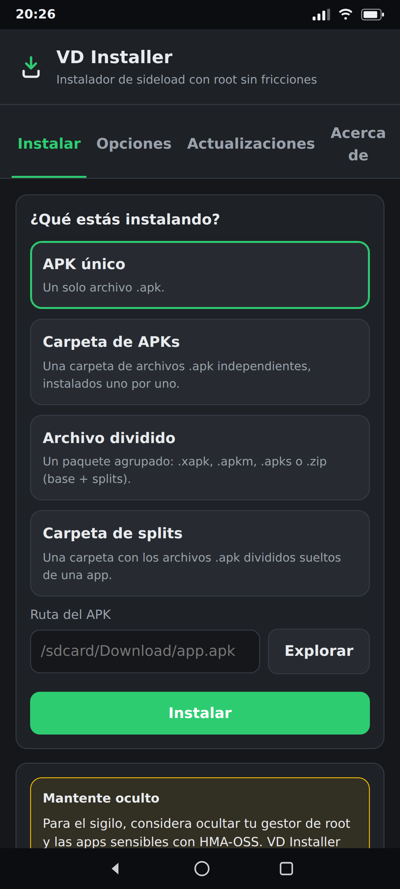
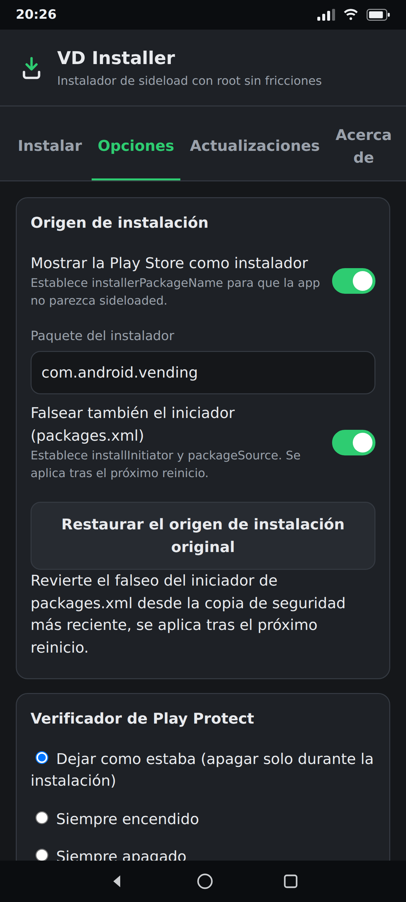
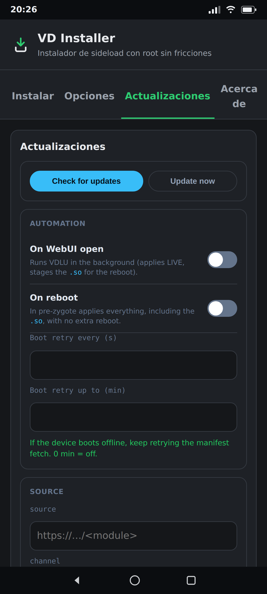
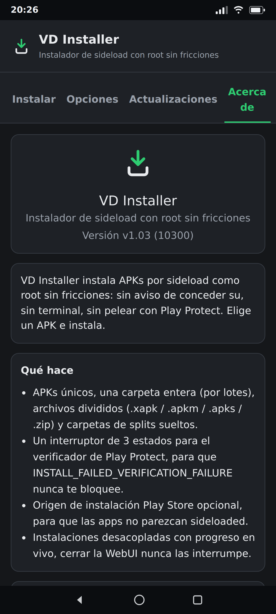

<!--
  ======================================================================
   VD INSTALLER  ::  frictionless root sideload installer
   Install sideload APKs as root (single/batch/split), no friction: KernelSU/APatch/Magisk WebUI.

   Copyright (C) 2026  VD171
   SPDX-License-Identifier: AGPL-3.0-or-later

   Free software under the GNU AGPL v3 or later. NETWORK COPYLEFT: run a
   modified version, even as a service, and you MUST offer its source.

   Site           : https://vd171.ru
   Site           : https://vd.priv8.ru
   Source         : https://github.com/VD171/VD-Installer
   GitHub         : @VD171 https://github.com/VD171
   XDA-Developers : @VD171 https://xdaforums.com/m/vd171.4699873/
   XDA thread     : https://xdaforums.com/t/VD-Installer.4809504/
   Telegram       : @VD_Priv8 https://t.me/VD_Priv8
   Channel        : @Priv8_VD https://t.me/Priv8_VD
   Discord        : @VD.Priv8 https://discord.com/users/1296831918989639721
   E-mail         : vd.priv8@pm.me
  ======================================================================
-->

> **Languages:** [English](README.md) · [العربية](README.ar.md) · [Čeština](README.cs.md) · [Deutsch](README.de.md) · Español · [فارسی](README.fa.md) · [Français](README.fr.md) · [हिन्दी](README.hi.md) · [Bahasa Indonesia](README.id.md) · [Italiano](README.it.md) · [日本語](README.ja.md) · [한국어](README.ko.md) · [Nederlands](README.nl.md) · [Polski](README.pl.md) · [Português](README.pt.md) · [Русский](README.ru.md) · [Svenska](README.sv.md) · [ไทย](README.th.md) · [Türkçe](README.tr.md) · [Українська](README.uk.md) · [Tiếng Việt](README.vi.md) · [中文](README.zh.md)

  

  
  
  
  

  <a href="https://github.com/VD171/VD-Installer/releases">Releases</a> ·
  <a href="https://github.com/VD171/VD-Installer/wiki">Wiki</a> ·
  <a href="https://github.com/VD171/VD-Installer/wiki/USER-GUIDE">Guía de usuario</a> ·
  <a href="https://github.com/VD171/VD-Installer/wiki/AI-AGENTS">Agentes de IA</a> ·
  <a href="https://github.com/VD171/VD-Installer/wiki/ARCHITECTURE">Arquitectura</a> ·
  <a href="https://github.com/VD171/VD-Installer/wiki/FILE-STRUCTURE">Estructura de archivos</a> ·
  <a href="https://github.com/VD171/VD-Installer/wiki/BINARIES">Binarios</a> ·
  <a href="CHANGELOG.md">Registro de cambios</a> ·
  <a href="https://xdaforums.com/t/VD-Installer.4809504/">XDA thread</a>

# VD Installer

> Instalador de sideload con root sin fricciones: KernelSU / APatch / Magisk WebUI.

## Capturas de pantalla

     

## Por qué

Instalar un APK por sideload en un teléfono con root es más ruidoso de lo que debería: el verificador
de paquetes de Play Protect puede lanzar `INSTALL_FAILED_VERIFICATION_FAILURE`, las apps divididas
(`.xapk` / `.apkm` / `.apks`) necesitan la session API a mano, y una app recién instalada se anuncia
como "sideloaded" a toda app que lea su origen de instalación. VDInstaller hace todo eso por ti, ya
como root, sin ningún aviso de "conceder su" y sin terminal.

## Características

- **Cualquier forma de APK:** un solo `.apk`, una carpeta entera de APKs independientes (batch), un
  archivo dividido agrupado (`.xapk` / `.apkm` / `.apks` / `.zip`), o una carpeta de APKs divididos
  sueltos.
- **Sin muro de verificación:** un interruptor de 3 estados para el verificador de paquetes de Play
  Protect: dejarlo como estaba (apagado solo durante la instalación, restaurado tal cual), siempre
  encendido o siempre apagado.
- **Honesto sobre la Verificación de Desarrollador:** una instalación con root ya está exenta de la
  Developer Verification de Android de 2026, el interruptor es de mejor esfuerzo y lo dice, nunca un
  interruptor falso.
- **No "sideloaded":** opcionalmente presenta el origen de instalación como la Play Store, tanto el
  instalador (en el momento de instalar) como el iniciador (mediante una edición de `packages.xml`
  consciente de ABX).
- **Independiente y reanudable:** las instalaciones corren como un proceso root independiente,
  cerrar la WebUI nunca las interrumpe, y la UI se reconecta por id de operación.
- **Tú decides:** paquetes de prueba, conceder todos los permisos de runtime,
  usuario de destino, saltarse el bloqueo de target SDK bajo: todo opcional.
- **Offline, autocontenido, sin reinicio:** un módulo WebUI con sus binarios incluidos, usable en el
  momento en que se flashea.

## Agentes de IA

Este proyecto da la bienvenida a colaboradores de IA y agentes. El motor habla JSON sobre un pequeño
contrato headless (`scripts/helper.sh <verb> <base64(JSON)>`), documentado en
[docs/AI-AGENTS.md](docs/AI-AGENTS.md), de modo que un agente puede ejecutar cada acción que la WebUI
puede, no raspes la WebUI. Los parches de IA se someten al mismo nivel de revisión que cualquier otro.

## Instalación

Flashea el zip en KernelSU, APatch o Magisk y abre la WebUI de VDInstaller desde tu gestor de root. El
instalador conserva solo la ABI de tu dispositivo y ejecuta la verificación obligatoria de integridad
`.sha256` (aborta ante un zip corrupto o truncado). Android 8.0 (API 26) o posterior.

## Seguridad

VDInstaller corre como root e instala los APKs que elijas, apagar el verificador de paquetes para una
instalación desactiva un escaneo de malware, así que instala solo APKs en los que confíes. Nunca
debilita la seguridad del dispositivo en silencio: por defecto el verificador se restaura a su estado
exacto anterior, y nunca toca tu configuración de HMA-OSS. Reporta problemas según [SECURITY.md](SECURITY.md).

## Compilación

Siempre release, nunca debug. `.github/scripts/build_bin.sh` obtiene `jq` del repositorio apt de Termux
(con su cierre de bibliotecas compartidas) y los conversores autónomos `abx2xml` / `xml2abx`, para las
cuatro ABIs, cada uno con un `PROVENANCE.json`. El workflow de release ensambla los zips flasheables,
escribe los compañeros `.sha256`, rellena `update.json` y publica como `github-actions[bot]`.

## Actualizaciones incrementales (VDLU)

VD Installer incluye el engine **[VDLiveUpdate](https://github.com/VD171/VDLiveUpdate) (VDLU)** (incorporado en `module/vdlu/`): el módulo se actualiza descargando solo los
archivos que cambiaron (blobs direccionados por contenido + un `manifest.json` firmado), en lugar de volver a
descargar el `.zip` completo. Perfil **reforzado**: la firma ed25519 es obligatoria y las degradaciones están
bloqueadas, el `.zip` completo sigue siendo válido como alternativa.

- **Solo LIVE** (sin reinicio): las actualizaciones se aplican en el siguiente arranque mediante `service.sh`, en segundo plano, sin efecto cuando no hay ningún feed accesible.
- **Estado** en `/data/adb/vdinstaller/vdlu/`, fuera del módulo, para que sobreviva a un reflasheo.
- **WebUI:** un panel **Actualizaciones** con un toast de progreso y cancelación, la actualización automática es opcional.

## Documentación

Las guías viven en [docs/](docs/) y se replican a la wiki de GitHub. Consulta
[docs/AI-AGENTS.md](docs/AI-AGENTS.md) para el contrato headless.

## Véase también

- **[COPG-VD](https://github.com/VD171/COPG-VD)**: spoofing global del fingerprint del dispositivo / Play Integrity, en todo el dispositivo con alcance por app y una WebUI.
- **[VDBackup](https://github.com/VD171/VD-Backup)**: copia de seguridad y restauración completas de apps y datos como root, gestionadas por completo desde una WebUI.
- **[VD-dropbear](https://github.com/VD171/VD-dropbear)**: un demonio SSH independiente con root (Dropbear).
- **[VDGoogle](https://github.com/VD171/VD-Google)**: tus servicios de Google (RCS, Wallet, atestaciones de Play Integrity), leídos en tu dispositivo sin internet.
- **[VDInfos](https://github.com/VD171/VD-Infos)**: un depurador de métodos del dispositivo que lee cada elemento a través de todos los métodos que pueden leerlo y los compara lado a lado.
- **[VDLiveUpdate](https://github.com/VD171/VDLiveUpdate)**: un motor de autoactualización incremental y sin flasheo, integrado en módulos KernelSU/APatch/Magisk.
- **[VD-Modules](https://github.com/VD171/VD-Modules)**: nuestro repositorio de módulos MMRL/WebUI-X (instala todos ellos desde tu gestor root).
- **[@VictorGabriel7Dev/build.prop](https://github.com/VictorGabriel7Dev/build.prop)**: un conjunto de datos de fingerprints `build.prop` de Pixel (fork de @T3SL4).
- **[@VictorGabriel7Dev/mtproto-store](https://github.com/VictorGabriel7Dev/mtproto-store)**: usa Telegram como object store desde una CLI de Go diminuta.

## Contactos

- https://vd171.ru
- https://vd.priv8.ru
- **Telegram:** @VD_Priv8 https://t.me/VD_Priv8
- **Channel:** @Priv8_VD https://t.me/Priv8_VD
- **Discord:** @VD.Priv8 https://discord.com/users/1296831918989639721
- **E-mail:** vd.priv8@pm.me
- **XDA-Developers:** @VD171 https://xdaforums.com/m/vd171.4699873/
- **XDA thread:** https://xdaforums.com/t/VD-Installer.4809504/
- **GitHub:** @VD171 https://github.com/VD171

## Licencia

VDInstaller está licenciado bajo la GNU AGPL-3.0-or-later. Consulta [LICENSE](LICENSE). NETWORK
COPYLEFT: ejecuta una versión modificada, incluso como servicio, y debes ofrecer su código fuente.

## Marcas registradas

Android, KernelSU, APatch, Magisk, Google Play y Play Protect pertenecen a sus respectivos dueños.
Este proyecto es independiente y no está afiliado ni respaldado por ellos.

## Tags

`android` `root` `kernelsu` `magisk` `apatch` `webui` `apk-installer` `sideload` `split-apk` `xapk` `vdinstaller`

---

📣 **Únete al canal para las actualizaciones:** @Priv8_VD https://t.me/Priv8_VD
