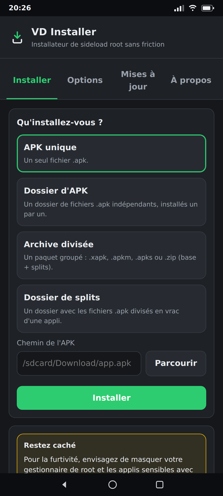
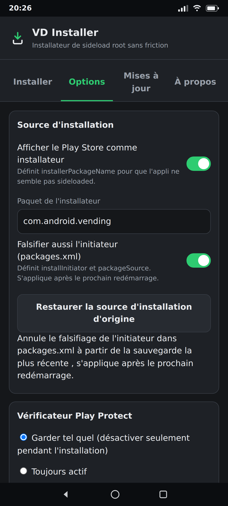
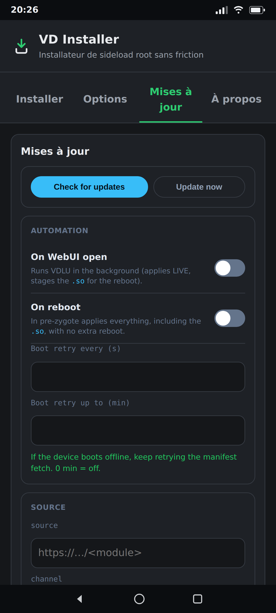
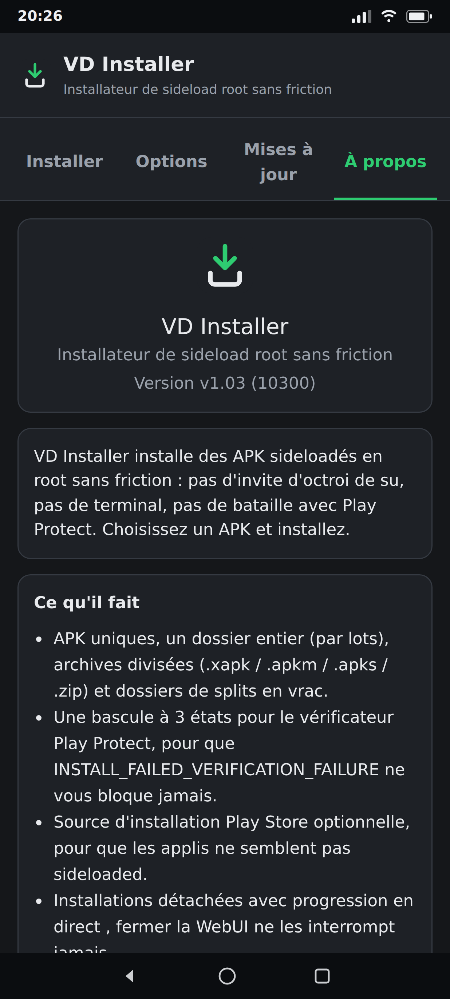

<!--
  ======================================================================
   VD INSTALLER  ::  frictionless root sideload installer
   Install sideload APKs as root (single/batch/split), no friction: KernelSU/APatch/Magisk WebUI.

   Copyright (C) 2026  VD171
   SPDX-License-Identifier: AGPL-3.0-or-later

   Free software under the GNU AGPL v3 or later. NETWORK COPYLEFT: run a
   modified version, even as a service, and you MUST offer its source.

   Site           : https://vd171.ru
   Site           : https://vd.priv8.ru
   Source         : https://github.com/VD171/VD-Installer
   GitHub         : @VD171 https://github.com/VD171
   XDA-Developers : @VD171 https://xdaforums.com/m/vd171.4699873/
   XDA thread     : https://xdaforums.com/t/VD-Installer.4809504/
   Telegram       : @VD_Priv8 https://t.me/VD_Priv8
   Channel        : @Priv8_VD https://t.me/Priv8_VD
   Discord        : @VD.Priv8 https://discord.com/users/1296831918989639721
   E-mail         : vd.priv8@pm.me
  ======================================================================
-->

> **Languages:** [English](README.md) · [العربية](README.ar.md) · [Čeština](README.cs.md) · [Deutsch](README.de.md) · [Español](README.es.md) · [فارسی](README.fa.md) · Français · [हिन्दी](README.hi.md) · [Bahasa Indonesia](README.id.md) · [Italiano](README.it.md) · [日本語](README.ja.md) · [한국어](README.ko.md) · [Nederlands](README.nl.md) · [Polski](README.pl.md) · [Português](README.pt.md) · [Русский](README.ru.md) · [Svenska](README.sv.md) · [ไทย](README.th.md) · [Türkçe](README.tr.md) · [Українська](README.uk.md) · [Tiếng Việt](README.vi.md) · [中文](README.zh.md)

  

  
  
  
  

  <a href="https://github.com/VD171/VD-Installer/releases">Releases</a> ·
  <a href="https://github.com/VD171/VD-Installer/wiki">Wiki</a> ·
  <a href="https://github.com/VD171/VD-Installer/wiki/USER-GUIDE">Guide de l'utilisateur</a> ·
  <a href="https://github.com/VD171/VD-Installer/wiki/AI-AGENTS">Agents d'IA</a> ·
  <a href="https://github.com/VD171/VD-Installer/wiki/ARCHITECTURE">Architecture</a> ·
  <a href="https://github.com/VD171/VD-Installer/wiki/FILE-STRUCTURE">Structure des fichiers</a> ·
  <a href="https://github.com/VD171/VD-Installer/wiki/BINARIES">Binaires</a> ·
  <a href="CHANGELOG.md">Journal des modifications</a> ·
  <a href="https://xdaforums.com/t/VD-Installer.4809504/">XDA thread</a>

# VD Installer

> Installateur de sideload root sans friction: KernelSU / APatch / Magisk WebUI.

## Captures d'écran

     

## Pourquoi

Installer un APK par sideload sur un téléphone rooté est plus bruyant que nécessaire : le vérificateur
de paquets de Play Protect peut renvoyer `INSTALL_FAILED_VERIFICATION_FAILURE`, les applis divisées
(`.xapk` / `.apkm` / `.apks`) exigent la session API à la main, et une appli fraîchement installée
s'annonce comme "sideloaded" à toute appli qui lit sa source d'installation. VDInstaller fait tout cela
pour vous, déjà en root, sans aucune invite "accorder su" ni terminal.

## Fonctionnalités

- **Toutes les formes d'APK:** un seul `.apk`, un dossier entier d'APK indépendants (batch), une
  archive divisée groupée (`.xapk` / `.apkm` / `.apks` / `.zip`), ou un dossier d'APK divisés en vrac.
- **Pas de mur de vérification:** une bascule à 3 états pour le vérificateur de paquets de Play
  Protect : le garder tel quel (désactivé seulement pendant l'installation, restauré à l'identique),
  toujours actif, ou toujours inactif.
- **Honnête sur la Vérification Développeur:** une installation en root est déjà exemptée de la
  Developer Verification d'Android de 2026, la bascule fait au mieux et le dit, jamais un faux
  interrupteur.
- **Pas "sideloaded":** présente en option la source d'installation comme le Play Store, à la fois
  l'installateur (au moment de l'installation) et l'initiateur (via une édition de `packages.xml`
  consciente d'ABX).
- **Détaché et reprenable:** les installations tournent comme un processus root détaché, fermer la
  WebUI ne les interrompt jamais, et l'interface se rattache par identifiant d'opération.
- **À vous de choisir:** paquets de test, accorder toutes les permissions runtime,
  utilisateur cible, contourner le blocage de target SDK bas : tout est optionnel.
- **Hors ligne, autonome, sans redémarrage:** un module WebUI avec ses binaires inclus, utilisable
  dès qu'il est flashé.

## Agents d'IA

Ce projet accueille les contributeurs IA et les agents. Le moteur parle JSON via un petit contrat
headless (`scripts/helper.sh <verb> <base64(JSON)>`), documenté dans
[docs/AI-AGENTS.md](docs/AI-AGENTS.md), afin qu'un agent puisse piloter chaque action que la WebUI
peut faire, ne scrapez pas la WebUI. Les correctifs issus d'IA sont tenus au même niveau de revue que
tout autre.

## Installation

Flashez le zip dans KernelSU, APatch ou Magisk et ouvrez la WebUI de VDInstaller depuis votre
gestionnaire de root. L'installateur ne conserve que l'ABI de votre appareil et exécute le contrôle
d'intégrité `.sha256` obligatoire (abandonne en cas de zip corrompu ou tronqué). Android 8.0 (API 26)
ou plus récent.

## Sécurité

VDInstaller tourne en root et installe les APK que vous choisissez, désactiver le vérificateur de
paquets pour une installation désactive une analyse de malware, alors n'installez que des APK de
confiance. Il n'affaiblit jamais la sécurité de l'appareil en silence : par défaut, le vérificateur est
restauré à son état antérieur exact, et il ne touche jamais à votre configuration HMA-OSS. Signalez les
problèmes selon [SECURITY.md](SECURITY.md).

## Compilation

Toujours release, jamais debug. `.github/scripts/build_bin.sh` récupère `jq` depuis le dépôt apt de
Termux (avec sa clôture de bibliothèques partagées) et les convertisseurs autonomes `abx2xml` /
`xml2abx`, pour les quatre ABI, chacun avec un `PROVENANCE.json`. Le workflow de release assemble les
zips flashables, écrit les compagnons `.sha256`, remplit `update.json` et publie en tant que
`github-actions[bot]`.

## Mises à jour incrémentielles (VDLU)

VD Installer embarque l'engine **[VDLiveUpdate](https://github.com/VD171/VDLiveUpdate) (VDLU)** (intégré dans `module/vdlu/`): le module se met à jour en ne récupérant que les
fichiers qui ont changé (blobs adressés par contenu + un `manifest.json` signé), au lieu de retélécharger tout
le `.zip`. Profil **durci**: la signature ed25519 est obligatoire et les rétrogradations sont bloquées, le
`.zip` complet reste valide comme solution de repli.

- **LIVE uniquement** (sans redémarrage): les mises à jour s'appliquent au prochain démarrage via `service.sh`, en arrière-plan, sans effet quand aucun feed n'est accessible.
- **État** dans `/data/adb/vdinstaller/vdlu/`, hors du module, pour survivre à un reflash.
- **WebUI:** un panneau **Mises à jour** avec un toast de progression et une annulation, la mise à jour automatique est en option.

## Documentation

Les guides se trouvent dans [docs/](docs/) et sont répliqués vers le wiki GitHub. Voir
[docs/AI-AGENTS.md](docs/AI-AGENTS.md) pour le contrat headless.

## Voir aussi

- **[COPG-VD](https://github.com/VD171/COPG-VD)** : spoofing global de l'empreinte de l'appareil / Play Integrity, sur tout l'appareil avec une portée par application et une WebUI.
- **[VDBackup](https://github.com/VD171/VD-Backup)** : sauvegarde et restauration complètes des applications et des données en root, pilotées entièrement depuis une WebUI.
- **[VD-dropbear](https://github.com/VD171/VD-dropbear)** : un démon SSH autonome avec les droits root (Dropbear).
- **[VDGoogle](https://github.com/VD171/VD-Google)** : vos services Google (RCS, Wallet, attestations Play Integrity), lus sur votre appareil sans internet.
- **[VDInfos](https://github.com/VD171/VD-Infos)** : un débogueur de méthodes de l'appareil qui lit chaque élément via toutes les méthodes capables de le lire et les compare côte à côte.
- **[VDLiveUpdate](https://github.com/VD171/VDLiveUpdate)** : un moteur d'auto-mise à jour incrémentale et sans flashage, intégré aux modules KernelSU/APatch/Magisk.
- **[VD-Modules](https://github.com/VD171/VD-Modules)** : notre dépôt de modules MMRL/WebUI-X (installez-les tous depuis votre gestionnaire root).
- **[@VictorGabriel7Dev/build.prop](https://github.com/VictorGabriel7Dev/build.prop)** : un jeu de données d'empreintes `build.prop` de Pixel (fork de @T3SL4).
- **[@VictorGabriel7Dev/mtproto-store](https://github.com/VictorGabriel7Dev/mtproto-store)** : utilisez Telegram comme object store depuis une petite CLI Go.

## Contacts

- https://vd171.ru
- https://vd.priv8.ru
- **Telegram:** @VD_Priv8 https://t.me/VD_Priv8
- **Channel:** @Priv8_VD https://t.me/Priv8_VD
- **Discord:** @VD.Priv8 https://discord.com/users/1296831918989639721
- **E-mail:** vd.priv8@pm.me
- **XDA-Developers:** @VD171 https://xdaforums.com/m/vd171.4699873/
- **XDA thread:** https://xdaforums.com/t/VD-Installer.4809504/
- **GitHub:** @VD171 https://github.com/VD171

## Licence

VDInstaller est sous licence GNU AGPL-3.0-or-later. Voir [LICENSE](LICENSE). NETWORK COPYLEFT : si vous
exécutez une version modifiée, même en tant que service, vous devez en offrir le code source.

## Marques

Android, KernelSU, APatch, Magisk, Google Play et Play Protect appartiennent à leurs propriétaires
respectifs. Ce projet est indépendant et n'est ni affilié à eux ni approuvé par eux.

## Tags

`android` `root` `kernelsu` `magisk` `apatch` `webui` `apk-installer` `sideload` `split-apk` `xapk` `vdinstaller`

---

📣 **Rejoignez le canal pour les mises à jour :** @Priv8_VD https://t.me/Priv8_VD
