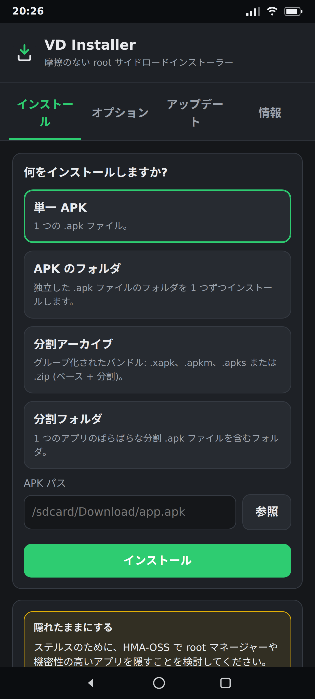
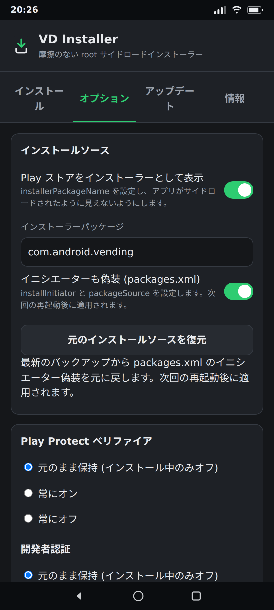
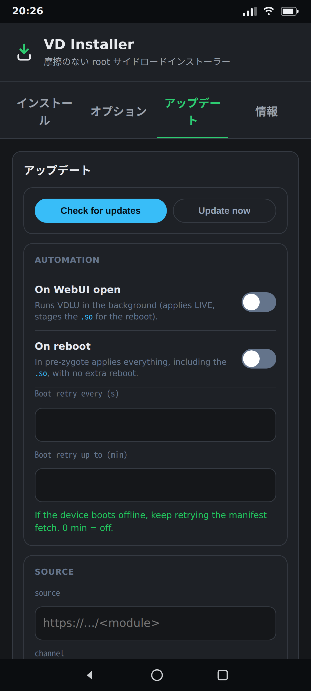
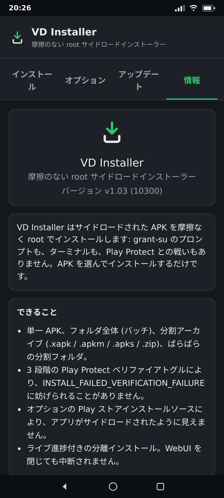

<!--
  ======================================================================
   VD INSTALLER  ::  frictionless root sideload installer
   Install sideload APKs as root (single/batch/split), no friction: KernelSU/APatch/Magisk WebUI.

   Copyright (C) 2026  VD171
   SPDX-License-Identifier: AGPL-3.0-or-later

   Free software under the GNU AGPL v3 or later. NETWORK COPYLEFT: run a
   modified version, even as a service, and you MUST offer its source.

   Site           : https://vd171.ru
   Site           : https://vd.priv8.ru
   Source         : https://github.com/VD171/VD-Installer
   GitHub         : @VD171 https://github.com/VD171
   XDA-Developers : @VD171 https://xdaforums.com/m/vd171.4699873/
   XDA thread     : https://xdaforums.com/t/VD-Installer.4809504/
   Telegram       : @VD_Priv8 https://t.me/VD_Priv8
   Channel        : @Priv8_VD https://t.me/Priv8_VD
   Discord        : @VD.Priv8 https://discord.com/users/1296831918989639721
   E-mail         : vd.priv8@pm.me
  ======================================================================
-->

> **Languages:** [English](README.md) · [العربية](README.ar.md) · [Čeština](README.cs.md) · [Deutsch](README.de.md) · [Español](README.es.md) · [فارسی](README.fa.md) · [Français](README.fr.md) · [हिन्दी](README.hi.md) · [Bahasa Indonesia](README.id.md) · [Italiano](README.it.md) · 日本語 · [한국어](README.ko.md) · [Nederlands](README.nl.md) · [Polski](README.pl.md) · [Português](README.pt.md) · [Русский](README.ru.md) · [Svenska](README.sv.md) · [ไทย](README.th.md) · [Türkçe](README.tr.md) · [Українська](README.uk.md) · [Tiếng Việt](README.vi.md) · [中文](README.zh.md)

  

  
  
  
  

  <a href="https://github.com/VD171/VD-Installer/releases">Releases</a> ·
  <a href="https://github.com/VD171/VD-Installer/wiki">Wiki</a> ·
  <a href="https://github.com/VD171/VD-Installer/wiki/USER-GUIDE">ユーザーガイド</a> ·
  <a href="https://github.com/VD171/VD-Installer/wiki/AI-AGENTS">AI エージェント</a> ·
  <a href="https://github.com/VD171/VD-Installer/wiki/ARCHITECTURE">アーキテクチャ</a> ·
  <a href="https://github.com/VD171/VD-Installer/wiki/FILE-STRUCTURE">ファイル構成</a> ·
  <a href="https://github.com/VD171/VD-Installer/wiki/BINARIES">同梱バイナリ</a> ·
  <a href="CHANGELOG.md">変更履歴</a> ·
  <a href="https://xdaforums.com/t/VD-Installer.4809504/">XDA thread</a>

# VD Installer

> 摩擦のない root サイドロードインストーラー: KernelSU / APatch / Magisk WebUI。

## スクリーンショット

     

## なぜ

root 化した端末でサイドロードした APK をインストールするのは、本来よりも面倒です。Play Protect の
パッケージベリファイアが `INSTALL_FAILED_VERIFICATION_FAILURE` を返すことがあり、分割アプリ
(`.xapk` / `.apkm` / `.apks`) はセッション API を手作業で扱う必要があり、インストールしたばかりの
アプリはインストール元を読む全アプリに対して自身を「サイドロード済み」と知らせます。VDInstaller は
これらすべてを、すでに root として、「su を許可」プロンプトもターミナルもなしに処理します。

## 機能

- **あらゆる形式の APK:** 単一の `.apk`、独立した APK をまとめたフォルダ (バッチ)、グループ化した
  分割アーカイブ (`.xapk` / `.apkm` / `.apks` / `.zip`)、またはばらばらの分割 APK のフォルダ。
- **検証の壁なし:** Play Protect パッケージベリファイアの 3 択トグル: 元のまま保持 (インストール中
  のみオフにし、そのまま正確に復元)、常にオン、または常にオフ。
- **開発者認証について正直:** root インストールは Android の 2026 年の開発者認証からすでに免除されて
  います。このトグルはベストエフォートであり、そのことを明示します。決して偽のスイッチではありません。
- **「サイドロード済み」にしない:** 任意で、インストール元を Play ストアとして提示します。インストーラー
  (インストール時) と開始者 (ABX 対応の `packages.xml` 編集経由) の両方。
- **デタッチ可能かつ再開可能:** インストールはデタッチされた root プロセスとして実行されます。WebUI
  を閉じても中断されず、UI は操作 ID で再接続します。
- **あなたの判断で:** テストパッケージ、すべての実行時権限の付与、ターゲットユーザー、
  低ターゲット SDK ブロックのバイパス: すべて任意です。
- **オフライン、自己完結、再起動不要:** バイナリを同梱した WebUI モジュール。フラッシュした瞬間から
  使用できます。

## AI エージェント

このプロジェクトは AI およびエージェントの貢献者を歓迎します。エンジンは小さなヘッドレス契約
(`scripts/helper.sh <verb> <base64(JSON)>`) 上で JSON を話し、[docs/AI-AGENTS.md](docs/AI-AGENTS.md)
に文書化されているため、エージェントは WebUI が行えるすべての操作を駆動できます, WebUI をスクレイプ
しないでください。AI からのパッチも他と同じレビュー基準で扱われます。

## インストール

KernelSU、APatch または Magisk で zip をフラッシュし、root マネージャーから VDInstaller WebUI を開きます。
インストーラーは端末の ABI のみを保持し、必須の `.sha256` 整合性ゲート (破損または切り詰められた zip で
中止) を実行します。Android 8.0 (API 26) 以降。

## セキュリティ

VDInstaller は root として実行され、あなたが選んだ APK をインストールします。インストールのために
パッケージベリファイアをオフにするとマルウェアスキャンが無効になるため、信頼できる APK のみを
インストールしてください。端末のセキュリティを黙って弱めることはありません。ベリファイアはデフォルトで
正確に以前の状態へ復元され、あなたの HMA-OSS 設定には決して触れません。問題は
[SECURITY.md](SECURITY.md) に従って報告してください。

## ビルド

常にリリース、デバッグは決して行いません。`.github/scripts/build_bin.sh` は Termux apt リポジトリから
`jq` (その共有ライブラリのクロージャ付き) とスタンドアロンの `abx2xml` / `xml2abx` コンバーターを、
4 つの ABI すべてについて、それぞれ `PROVENANCE.json` 付きで取得します。リリースワークフローは
フラッシュ可能な zip を組み立て、`.sha256` の対応物を書き込み、`update.json` を埋め、
`github-actions[bot]` として公開します。

## 差分アップデート (VDLU)

VD Installer は **[VDLiveUpdate](https://github.com/VD171/VDLiveUpdate) (VDLU)** エンジンを同梱しています (`module/vdlu/` に同梱)。モジュールは `.zip` 全体を再ダウンロードするのではなく、変更されたファイルだけを取得して自分自身を更新します (コンテンツアドレス指定のブロブ + 署名付きの `manifest.json`)。**堅牢化** プロファイル: ed25519 署名は必須で、ダウングレードはブロックされます。完全な `.zip` はフォールバックとして引き続き有効です。

- **LIVE のみ** (再起動なし): アップデートは `service.sh` 経由で次回起動時にバックグラウンドで適用され、到達可能なフィードがない場合は何もしません。
- **状態** は `/data/adb/vdinstaller/vdlu/` にあり、モジュールの外にあるため再フラッシュしても残ります。
- **WebUI:** 進捗トーストとキャンセルを備えた **アップデート** パネル。自動更新はオプトインです。

## ドキュメント

ガイドは [docs/](docs/) にあり、GitHub wiki にミラーされます。ヘッドレス契約については
[docs/AI-AGENTS.md](docs/AI-AGENTS.md) を参照してください。

## 関連項目

- **[COPG-VD](https://github.com/VD171/COPG-VD)**: デバイスの fingerprint / Play Integrity のグローバルなスプーフィング。端末全体を対象に、アプリ単位のスコープと WebUI を備えます。
- **[VDBackup](https://github.com/VD171/VD-Backup)**: アプリとデータの完全なバックアップと復元を root として行い、すべて WebUI から操作します。
- **[VD-dropbear](https://github.com/VD171/VD-dropbear)**: root として動作するスタンドアロンの SSH デーモン (Dropbear)。
- **[VDGoogle](https://github.com/VD171/VD-Google)**: あなたの Google サービス (RCS、Wallet、Play Integrity の認証) を、インターネットなしで端末上で読み取ります。
- **[VDInfos](https://github.com/VD171/VD-Infos)**: 各項目を、それを読み取れるあらゆるメソッドを通して読み取り、並べて比較するデバイスメソッドデバッガーです。
- **[VDLiveUpdate](https://github.com/VD171/VDLiveUpdate)**: フラッシュ不要の増分セルフアップデートエンジンで、KernelSU/APatch/Magisk モジュールに組み込まれます。
- **[VD-Modules](https://github.com/VD171/VD-Modules)**: 私たちの MMRL/WebUI-X モジュールリポジトリ（これらすべてを root マネージャーからインストールできます）。
- **[@VictorGabriel7Dev/build.prop](https://github.com/VictorGabriel7Dev/build.prop)**: Pixel の `build.prop` fingerprint のデータセット（@T3SL4 のフォーク）。
- **[@VictorGabriel7Dev/mtproto-store](https://github.com/VictorGabriel7Dev/mtproto-store)**: 小さな Go CLI から Telegram をオブジェクトストアとして使います。

## 連絡先

- https://vd171.ru
- https://vd.priv8.ru
- **Telegram:** @VD_Priv8 https://t.me/VD_Priv8
- **Channel:** @Priv8_VD https://t.me/Priv8_VD
- **Discord:** @VD.Priv8 https://discord.com/users/1296831918989639721
- **E-mail:** vd.priv8@pm.me
- **XDA-Developers:** @VD171 https://xdaforums.com/m/vd171.4699873/
- **XDA thread:** https://xdaforums.com/t/VD-Installer.4809504/
- **GitHub:** @VD171 https://github.com/VD171

## ライセンス

VDInstaller は GNU AGPL-3.0-or-later の下でライセンスされています。[LICENSE](LICENSE) を参照してください。
NETWORK COPYLEFT: 変更したバージョンを、サービスとしてであっても実行する場合、そのソースを提供しなければ
なりません。

## 商標

Android、KernelSU、APatch、Magisk、Google Play、Play Protect はそれぞれの所有者に帰属します。
本プロジェクトは独立したものであり、これらと提携または承認を受けたものではありません。

## タグ

`android` `root` `kernelsu` `magisk` `apatch` `webui` `apk-installer` `sideload` `split-apk` `xapk` `vdinstaller`

---

📣 **更新はチャンネルに参加してください：** @Priv8_VD https://t.me/Priv8_VD
