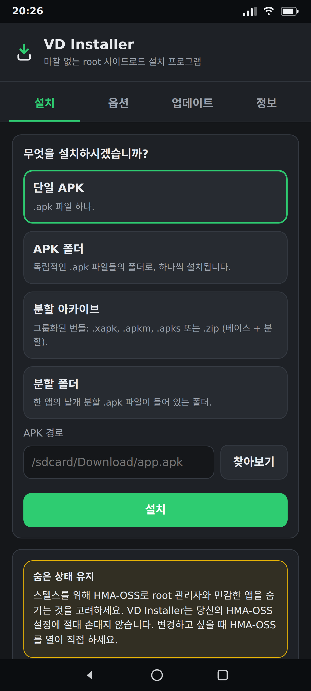
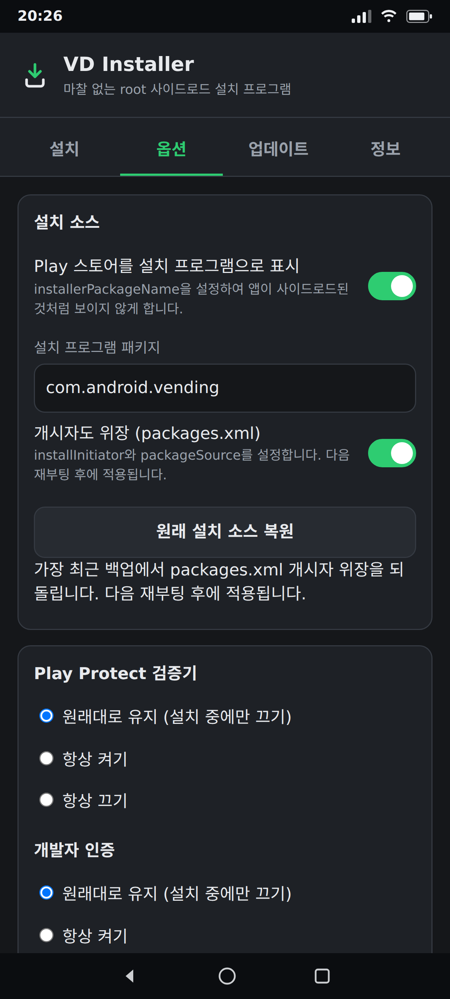
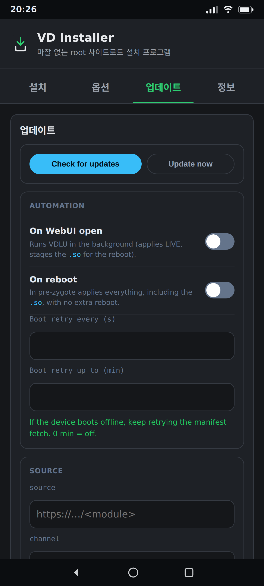
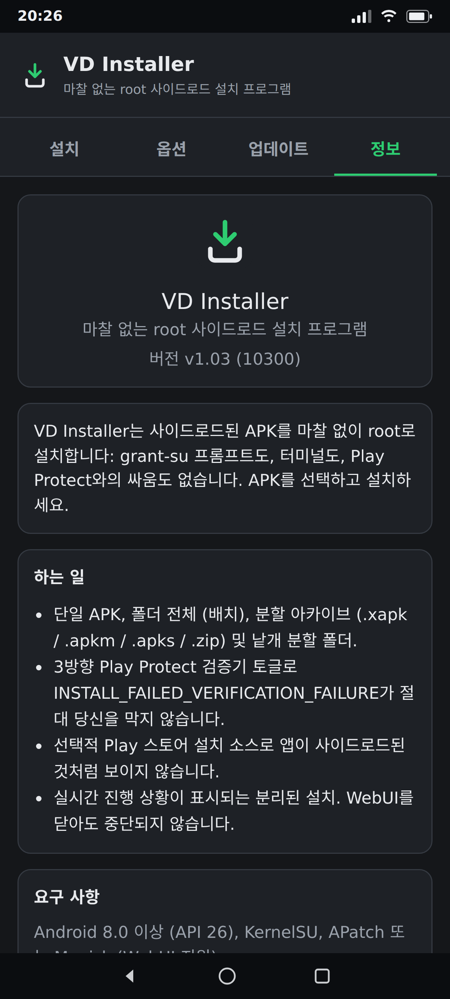

<!--
  ======================================================================
   VD INSTALLER  ::  frictionless root sideload installer
   Install sideload APKs as root (single/batch/split), no friction: KernelSU/APatch/Magisk WebUI.

   Copyright (C) 2026  VD171
   SPDX-License-Identifier: AGPL-3.0-or-later

   Free software under the GNU AGPL v3 or later. NETWORK COPYLEFT: run a
   modified version, even as a service, and you MUST offer its source.

   Site           : https://vd171.ru
   Site           : https://vd.priv8.ru
   Source         : https://github.com/VD171/VD-Installer
   GitHub         : @VD171 https://github.com/VD171
   XDA-Developers : @VD171 https://xdaforums.com/m/vd171.4699873/
   XDA thread     : https://xdaforums.com/t/VD-Installer.4809504/
   Telegram       : @VD_Priv8 https://t.me/VD_Priv8
   Channel        : @Priv8_VD https://t.me/Priv8_VD
   Discord        : @VD.Priv8 https://discord.com/users/1296831918989639721
   E-mail         : vd.priv8@pm.me
  ======================================================================
-->

> **Languages:** [English](README.md) · [العربية](README.ar.md) · [Čeština](README.cs.md) · [Deutsch](README.de.md) · [Español](README.es.md) · [فارسی](README.fa.md) · [Français](README.fr.md) · [हिन्दी](README.hi.md) · [Bahasa Indonesia](README.id.md) · [Italiano](README.it.md) · [日本語](README.ja.md) · 한국어 · [Nederlands](README.nl.md) · [Polski](README.pl.md) · [Português](README.pt.md) · [Русский](README.ru.md) · [Svenska](README.sv.md) · [ไทย](README.th.md) · [Türkçe](README.tr.md) · [Українська](README.uk.md) · [Tiếng Việt](README.vi.md) · [中文](README.zh.md)

  

  
  
  
  

  <a href="https://github.com/VD171/VD-Installer/releases">Releases</a> ·
  <a href="https://github.com/VD171/VD-Installer/wiki">Wiki</a> ·
  <a href="https://github.com/VD171/VD-Installer/wiki/USER-GUIDE">사용자 가이드</a> ·
  <a href="https://github.com/VD171/VD-Installer/wiki/AI-AGENTS">AI 에이전트</a> ·
  <a href="https://github.com/VD171/VD-Installer/wiki/ARCHITECTURE">아키텍처</a> ·
  <a href="https://github.com/VD171/VD-Installer/wiki/FILE-STRUCTURE">파일 구조</a> ·
  <a href="https://github.com/VD171/VD-Installer/wiki/BINARIES">포함된 바이너리</a> ·
  <a href="CHANGELOG.md">변경 이력</a> ·
  <a href="https://xdaforums.com/t/VD-Installer.4809504/">XDA thread</a>

# VD Installer

> 마찰 없는 root 사이드로드 설치 프로그램: KernelSU / APatch / Magisk WebUI.

## 스크린샷

     

## 이유

root 화된 휴대폰에서 사이드로드한 APK를 설치하는 것은 필요 이상으로 번거롭습니다. Play Protect의
패키지 검증기가 `INSTALL_FAILED_VERIFICATION_FAILURE`를 낼 수 있고, 분할 앱(`.xapk` / `.apkm` /
`.apks`)은 세션 API를 수동으로 다뤄야 하며, 방금 설치된 앱은 설치 소스를 읽는 모든 앱에 자신이
"사이드로드됨"이라고 알립니다. VDInstaller는 이 모든 것을 이미 root로서, "su 허용" 프롬프트도
터미널도 없이 처리합니다.

## 기능

- **모든 형태의 APK:** 단일 `.apk`, 독립적인 APK로 이루어진 폴더 전체(배치), 그룹화된 분할
  아카이브(`.xapk` / `.apkm` / `.apks` / `.zip`), 또는 낱개 분할 APK의 폴더.
- **검증의 벽 없음:** Play Protect 패키지 검증기를 위한 3방향 토글: 원래대로 유지(설치 중에만 끄고
  정확히 복원), 항상 켜기, 또는 항상 끄기.
- **개발자 인증에 대해 정직함:** root 설치는 이미 Android의 2026년 개발자 인증에서 면제됩니다. 이
  토글은 최선의 노력이며 그 점을 밝히며, 결코 가짜 스위치가 아닙니다.
- **"사이드로드됨"이 아님:** 선택적으로 설치 소스를 Play 스토어로 제시합니다. 설치 프로그램(설치
  시점)과 개시자(ABX를 인식하는 `packages.xml` 편집을 통해) 모두.
- **분리 가능하고 재개 가능:** 설치는 분리된 root 프로세스로 실행됩니다. WebUI를 닫아도 중단되지
  않으며, UI는 작업 ID로 다시 연결됩니다.
- **당신의 선택:** 테스트 패키지, 모든 런타임 권한 부여, 대상 사용자, 낮은 타겟 SDK
  차단 우회: 모두 선택 사항입니다.
- **오프라인, 자체 완결, 재부팅 불필요:** 바이너리가 번들된 WebUI 모듈. 플래시하는 순간부터
  사용할 수 있습니다.

## AI 에이전트

이 프로젝트는 AI 및 에이전트 기여자를 환영합니다. 엔진은 작은 헤드리스 계약
(`scripts/helper.sh <verb> <base64(JSON)>`) 위에서 JSON으로 통신하며, 이는
[docs/AI-AGENTS.md](docs/AI-AGENTS.md)에 문서화되어 있어 에이전트가 WebUI가 할 수 있는 모든
작업을 구동할 수 있습니다, WebUI를 스크레이프하지 마세요. AI의 패치도 다른 것과 동일한 검토
기준으로 다룹니다.

## 설치

KernelSU, APatch 또는 Magisk에서 zip을 플래시하고 root 관리자에서 VDInstaller WebUI를 엽니다.
설치 프로그램은 기기의 ABI만 유지하고 필수 `.sha256` 무결성 게이트(손상되거나 잘린 zip에서 중단)를
실행합니다. Android 8.0(API 26) 이상.

## 보안

VDInstaller는 root로 실행되며 당신이 선택한 APK를 설치합니다. 설치를 위해 패키지 검증기를 끄면
멀웨어 검사가 비활성화되므로 신뢰하는 APK만 설치하세요. 기기 보안을 조용히 약화시키는 일은 없습니다.
검증기는 기본적으로 정확히 이전 상태로 복원되며, 당신의 HMA-OSS 설정에는 결코 손대지 않습니다.
문제는 [SECURITY.md](SECURITY.md)에 따라 보고하세요.

## 빌드

항상 릴리스, 디버그는 결코 하지 않습니다. `.github/scripts/build_bin.sh`는 Termux apt 저장소에서
`jq`(그 공유 라이브러리 클로저 포함)와 독립형 `abx2xml` / `xml2abx` 변환기를 4개 ABI 모두에 대해
각각 `PROVENANCE.json`과 함께 가져옵니다. 릴리스 워크플로는 플래시 가능한 zip을 조립하고 `.sha256`
동반 파일을 쓰고 `update.json`을 채우며 `github-actions[bot]`로 게시합니다.

## 증분 업데이트 (VDLU)

VD Installer는 **[VDLiveUpdate](https://github.com/VD171/VDLiveUpdate) (VDLU)** 엔진을 포함합니다 (`module/vdlu/`에 내장). 모듈은 전체 `.zip`을 다시 내려받는 대신 변경된 파일만 가져와 자신을 업데이트합니다 (콘텐츠 주소 지정 블롭 + 서명된 `manifest.json`). **강화된** 프로파일: ed25519 서명이 필수이며 다운그레이드는 차단됩니다. 전체 `.zip`은 폴백으로 계속 유효합니다.

- **LIVE 전용** (재부팅 없음): 업데이트는 `service.sh`를 통해 다음 부팅 시 백그라운드로 적용되며, 도달 가능한 피드가 없으면 아무 작업도 하지 않습니다.
- **상태**는 `/data/adb/vdinstaller/vdlu/`에 있으며, 모듈 외부에 있으므로 재플래시 후에도 유지됩니다.
- **WebUI:** 진행 토스트와 취소가 있는 **업데이트** 패널이며, 자동 업데이트는 옵트인입니다.

## 문서

가이드는 [docs/](docs/)에 있으며 GitHub wiki에 미러됩니다. 헤드리스 계약에 대해서는
[docs/AI-AGENTS.md](docs/AI-AGENTS.md)를 참조하세요.

## 참고

- **[COPG-VD](https://github.com/VD171/COPG-VD)**: 기기 fingerprint / Play Integrity의 전역 스푸핑. 앱별 범위와 WebUI를 갖추고 기기 전체에 적용됩니다.
- **[VDBackup](https://github.com/VD171/VD-Backup)**: 앱과 데이터의 전체 백업과 복원을 root로 수행하며, 전적으로 WebUI에서 제어합니다.
- **[VD-dropbear](https://github.com/VD171/VD-dropbear)**: root로 동작하는 독립 실행형 SSH 데몬 (Dropbear).
- **[VDGoogle](https://github.com/VD171/VD-Google)**: 당신의 Google 서비스(RCS, Wallet, Play Integrity 증명)를 인터넷 없이 기기에서 읽습니다.
- **[VDInfos](https://github.com/VD171/VD-Infos)**: 각 항목을 그것을 읽을 수 있는 모든 메서드를 통해 읽고 나란히 비교하는 기기 메서드 디버거입니다.
- **[VDLiveUpdate](https://github.com/VD171/VDLiveUpdate)**: KernelSU/APatch/Magisk 모듈에 내장된, 플래시가 필요 없는 증분 자가 업데이트 엔진.
- **[VD-Modules](https://github.com/VD171/VD-Modules)**: 우리의 MMRL/WebUI-X 모듈 저장소 (루트 관리자에서 이 모두를 설치하세요).
- **[@VictorGabriel7Dev/build.prop](https://github.com/VictorGabriel7Dev/build.prop)**: Pixel `build.prop` fingerprint 데이터세트 (@T3SL4의 포크).
- **[@VictorGabriel7Dev/mtproto-store](https://github.com/VictorGabriel7Dev/mtproto-store)**: 작은 Go CLI로 Telegram을 객체 저장소로 사용하세요.

## 연락처

- https://vd171.ru
- https://vd.priv8.ru
- **Telegram:** @VD_Priv8 https://t.me/VD_Priv8
- **Channel:** @Priv8_VD https://t.me/Priv8_VD
- **Discord:** @VD.Priv8 https://discord.com/users/1296831918989639721
- **E-mail:** vd.priv8@pm.me
- **XDA-Developers:** @VD171 https://xdaforums.com/m/vd171.4699873/
- **XDA thread:** https://xdaforums.com/t/VD-Installer.4809504/
- **GitHub:** @VD171 https://github.com/VD171

## 라이선스

VDInstaller는 GNU AGPL-3.0-or-later로 라이선스됩니다. [LICENSE](LICENSE)를 참조하세요.
NETWORK COPYLEFT: 변경한 버전을 서비스로서라도 실행하는 경우, 그 소스를 제공해야 합니다.

## 상표

Android, KernelSU, APatch, Magisk, Google Play 및 Play Protect는 각 소유자에게 귀속됩니다.
이 프로젝트는 독립적이며 이들과 제휴하거나 승인받지 않았습니다.

## 태그

`android` `root` `kernelsu` `magisk` `apatch` `webui` `apk-installer` `sideload` `split-apk` `xapk` `vdinstaller`

---

📣 **업데이트를 받으려면 채널에 참여하세요:** @Priv8_VD https://t.me/Priv8_VD
