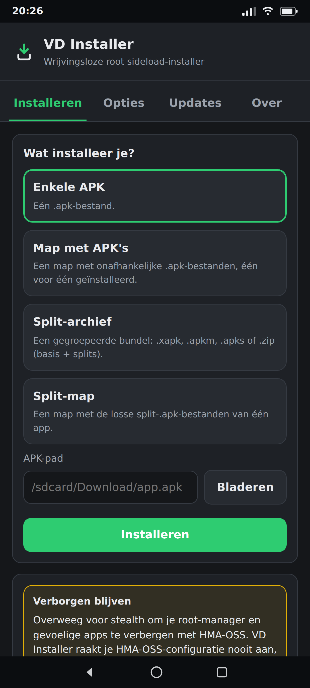
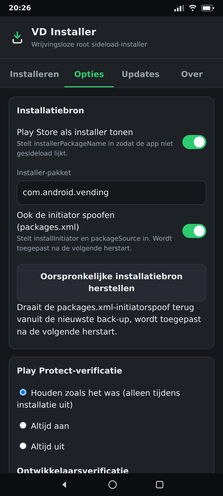
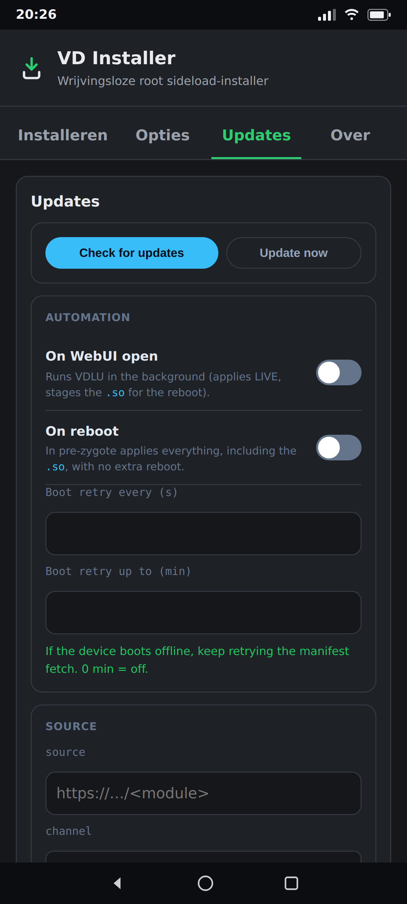
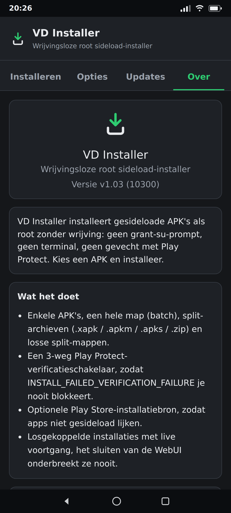

<!--
  ======================================================================
   VD INSTALLER  ::  frictionless root sideload installer
   Install sideload APKs as root (single/batch/split), no friction: KernelSU/APatch/Magisk WebUI.

   Copyright (C) 2026  VD171
   SPDX-License-Identifier: AGPL-3.0-or-later

   Free software under the GNU AGPL v3 or later. NETWORK COPYLEFT: run a
   modified version, even as a service, and you MUST offer its source.

   Site           : https://vd171.ru
   Site           : https://vd.priv8.ru
   Source         : https://github.com/VD171/VD-Installer
   GitHub         : @VD171 https://github.com/VD171
   XDA-Developers : @VD171 https://xdaforums.com/m/vd171.4699873/
   XDA thread     : https://xdaforums.com/t/VD-Installer.4809504/
   Telegram       : @VD_Priv8 https://t.me/VD_Priv8
   Channel        : @Priv8_VD https://t.me/Priv8_VD
   Discord        : @VD.Priv8 https://discord.com/users/1296831918989639721
   E-mail         : vd.priv8@pm.me
  ======================================================================
-->

> **Languages:** [English](README.md) · [العربية](README.ar.md) · [Čeština](README.cs.md) · [Deutsch](README.de.md) · [Español](README.es.md) · [فارسی](README.fa.md) · [Français](README.fr.md) · [हिन्दी](README.hi.md) · [Bahasa Indonesia](README.id.md) · [Italiano](README.it.md) · [日本語](README.ja.md) · [한국어](README.ko.md) · Nederlands · [Polski](README.pl.md) · [Português](README.pt.md) · [Русский](README.ru.md) · [Svenska](README.sv.md) · [ไทย](README.th.md) · [Türkçe](README.tr.md) · [Українська](README.uk.md) · [Tiếng Việt](README.vi.md) · [中文](README.zh.md)

  

  
  
  
  

  <a href="https://github.com/VD171/VD-Installer/releases">Releases</a> ·
  <a href="https://github.com/VD171/VD-Installer/wiki">Wiki</a> ·
  <a href="https://github.com/VD171/VD-Installer/wiki/USER-GUIDE">Gebruikershandleiding</a> ·
  <a href="https://github.com/VD171/VD-Installer/wiki/AI-AGENTS">AI-agenten</a> ·
  <a href="https://github.com/VD171/VD-Installer/wiki/ARCHITECTURE">Architectuur</a> ·
  <a href="https://github.com/VD171/VD-Installer/wiki/FILE-STRUCTURE">Bestandsstructuur</a> ·
  <a href="https://github.com/VD171/VD-Installer/wiki/BINARIES">Meegeleverde binaries</a> ·
  <a href="CHANGELOG.md">Changelog</a> ·
  <a href="https://xdaforums.com/t/VD-Installer.4809504/">XDA thread</a>

# VD Installer

> Wrijvingsloze root sideload-installer: KernelSU / APatch / Magisk WebUI.

## Schermafbeeldingen

     

## Waarom

Een gesideloade APK installeren op een geroote telefoon is rommeliger dan het zou moeten zijn: de
pakketverificatie van Play Protect kan `INSTALL_FAILED_VERIFICATION_FAILURE` geven, split-apps
(`.xapk` / `.apkm` / `.apks`) vereisen de session-API met de hand, en een pas geïnstalleerde app
kondigt zichzelf aan als "gesideload" bij elke app die de installatiebron leest. VDInstaller doet dit
allemaal voor je, al als root, zonder "verleen su"-prompt en zonder terminal.

## Functies

- **Elke vorm van APK:** een enkele `.apk`, een hele map met onafhankelijke APK's (batch), een
  gegroepeerd split-archief (`.xapk` / `.apkm` / `.apks` / `.zip`), of een map met losse split-APK's.
- **Geen verificatiemuur:** een 3-weg-schakelaar voor de Play Protect-pakketverificatie: houden zoals
  het was (alleen uit tijdens de installatie, exact hersteld), altijd aan, of altijd uit.
- **Eerlijk over Ontwikkelaarsverificatie:** een root-installatie is al vrijgesteld van Androids
  Ontwikkelaarsverificatie van 2026, de schakelaar is best-effort en zegt dat ook, nooit een nep-knop.
- **Niet "gesideload":** presenteert optioneel de installatiebron als de Play Store, zowel de
  installer (op installatietijd) als de initiator (via een ABX-bewuste `packages.xml`-bewerking).
- **Losgekoppeld en hervatbaar:** installaties draaien als een losgekoppeld root-proces, het sluiten
  van de WebUI onderbreekt ze nooit, en de UI koppelt opnieuw aan op operatie-id.
- **Jouw keuze:** testpakketten, alle runtime-machtigingen verlenen, doelgebruiker, de
  blokkade voor lage doel-SDK omzeilen: allemaal optioneel.
- **Offline, zelfstandig, herstart-vrij:** een WebUI-module met zijn binaries gebundeld, bruikbaar op
  het moment dat hij geflasht is.

## AI-agents

Dit project verwelkomt AI- en agent-bijdragers. De engine spreekt JSON over een klein headless
contract (`scripts/helper.sh <verb> <base64(JSON)>`), gedocumenteerd in
[docs/AI-AGENTS.md](docs/AI-AGENTS.md), zodat een agent elke actie kan aansturen die de WebUI kan -
scrape de WebUI niet. Patches van AI worden aan dezelfde reviewlat gehouden als alle andere.

## Installeren

Flash de zip in KernelSU, APatch of Magisk en open de VDInstaller-WebUI vanuit je root-manager. De
installer houdt alleen de ABI van je apparaat en draait de verplichte `.sha256`-integriteitsgate
(breekt af bij een beschadigde of afgekapte zip). Android 8.0 (API 26) of nieuwer.

## Beveiliging

VDInstaller draait als root en installeert APK's die jij kiest, de pakketverificatie uitzetten voor
een installatie schakelt een malwarescan uit, dus installeer alleen APK's die je vertrouwt. Het
verzwakt de apparaatbeveiliging nooit stilletjes: de verificatie wordt standaard exact in zijn vorige
staat hersteld, en het raakt je HMA-OSS-configuratie nooit aan. Meld problemen volgens
[SECURITY.md](SECURITY.md).

## Bouwen

Altijd release, nooit debug. `.github/scripts/build_bin.sh` haalt `jq` op uit de Termux apt-repository
(met zijn gedeelde-bibliotheeksluiting) en de standalone `abx2xml` / `xml2abx`-converters, voor alle
vier ABI's, elk met een `PROVENANCE.json`. De release-workflow stelt de flashbare zips samen, schrijft
`.sha256`-begeleiders, vult `update.json` en publiceert als `github-actions[bot]`.

## Incrementele updates (VDLU)

VD Installer bevat de **[VDLiveUpdate](https://github.com/VD171/VDLiveUpdate) (VDLU)**-engine (ingebouwd in `module/vdlu/`): de module werkt zichzelf bij door alleen de
bestanden op te halen die zijn gewijzigd (inhoud-geadresseerde blobs + een ondertekende `manifest.json`), in
plaats van de hele `.zip` opnieuw te downloaden. **Gehard** profiel: de ed25519-handtekening is verplicht en
downgrades worden geblokkeerd, de volledige `.zip` blijft geldig als terugval.

- **Alleen LIVE** (geen herstart): updates worden bij de volgende start toegepast via `service.sh`, op de achtergrond, een no-op wanneer er geen feed bereikbaar is.
- **Status** in `/data/adb/vdinstaller/vdlu/`, buiten de module, zodat het een herflash overleeft.
- **WebUI:** een paneel **Updates** met een voortgangstoast en annuleren, automatisch bijwerken is opt-in.

## Documentatie

Gidsen staan in [docs/](docs/) en spiegelen naar de GitHub-wiki. Zie
[docs/AI-AGENTS.md](docs/AI-AGENTS.md) voor het headless contract.

## Zie ook

- **[COPG-VD](https://github.com/VD171/COPG-VD)**: globale spoofing van apparaat-fingerprint / Play Integrity, voor het hele toestel met bereik per app en een WebUI.
- **[VDBackup](https://github.com/VD171/VD-Backup)**: volledige back-up en herstel van apps en gegevens als root, volledig aangestuurd vanuit een WebUI.
- **[VD-dropbear](https://github.com/VD171/VD-dropbear)**: een standalone geroote SSH-daemon (Dropbear).
- **[VDGoogle](https://github.com/VD171/VD-Google)**: je Google-diensten (RCS, Wallet, Play Integrity-attestaties), gelezen op je toestel zonder internet.
- **[VDInfos](https://github.com/VD171/VD-Infos)**: een apparaat-methodedebugger die elk item leest via elke methode die het kan lezen en ze naast elkaar vergelijkt.
- **[VDLiveUpdate](https://github.com/VD171/VDLiveUpdate)**: een flashloze, incrementele zelfupdate-engine, ingebed in KernelSU/APatch/Magisk-modules.
- **[VD-Modules](https://github.com/VD171/VD-Modules)**: onze MMRL/WebUI-X-module-repository (installeer ze allemaal vanuit je root-manager).
- **[@VictorGabriel7Dev/build.prop](https://github.com/VictorGabriel7Dev/build.prop)**: een dataset van Pixel-`build.prop`-fingerprints (fork van @T3SL4).
- **[@VictorGabriel7Dev/mtproto-store](https://github.com/VictorGabriel7Dev/mtproto-store)**: gebruik Telegram als object store vanuit een kleine Go-CLI.

## Contacten

- https://vd171.ru
- https://vd.priv8.ru
- **Telegram:** @VD_Priv8 https://t.me/VD_Priv8
- **Channel:** @Priv8_VD https://t.me/Priv8_VD
- **Discord:** @VD.Priv8 https://discord.com/users/1296831918989639721
- **E-mail:** vd.priv8@pm.me
- **XDA-Developers:** @VD171 https://xdaforums.com/m/vd171.4699873/
- **XDA thread:** https://xdaforums.com/t/VD-Installer.4809504/
- **GitHub:** @VD171 https://github.com/VD171

## Licentie

VDInstaller is gelicentieerd onder de GNU AGPL-3.0-or-later. Zie [LICENSE](LICENSE). NETWORK COPYLEFT:
draai een gewijzigde versie, zelfs als een service, en je moet de bron ervan aanbieden.

## Handelsmerken

Android, KernelSU, APatch, Magisk, Google Play en Play Protect behoren toe aan hun respectieve
eigenaren. Dit project is onafhankelijk en niet verbonden met of onderschreven door hen.

## Tags

`android` `root` `kernelsu` `magisk` `apatch` `webui` `apk-installer` `sideload` `split-apk` `xapk` `vdinstaller`

---

📣 **Word lid van het kanaal voor updates:** @Priv8_VD https://t.me/Priv8_VD
