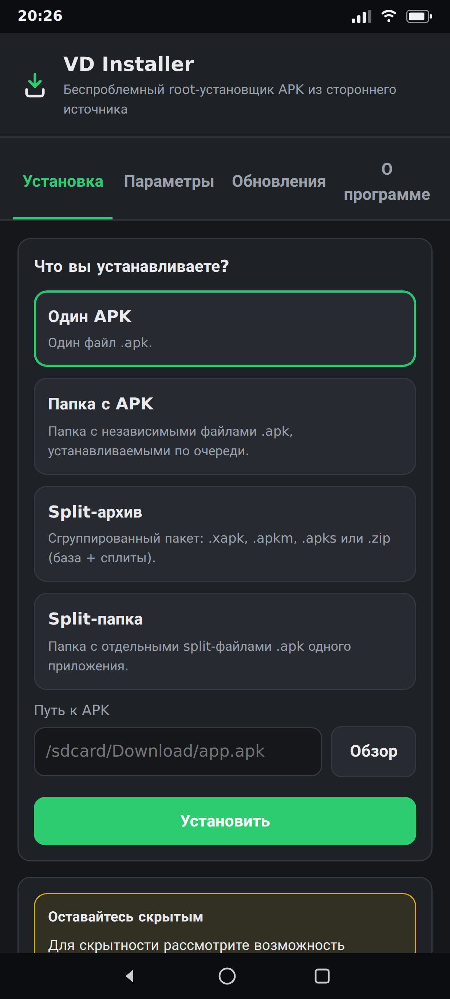
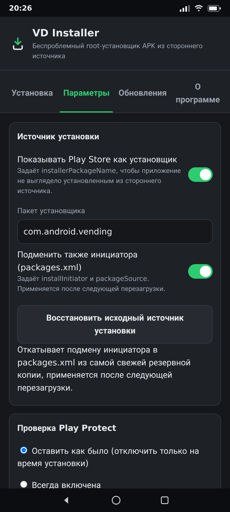
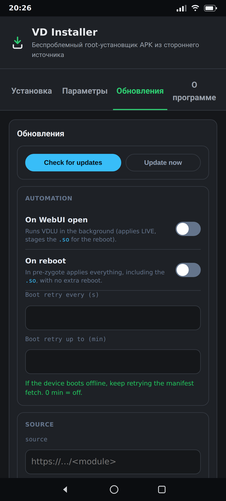
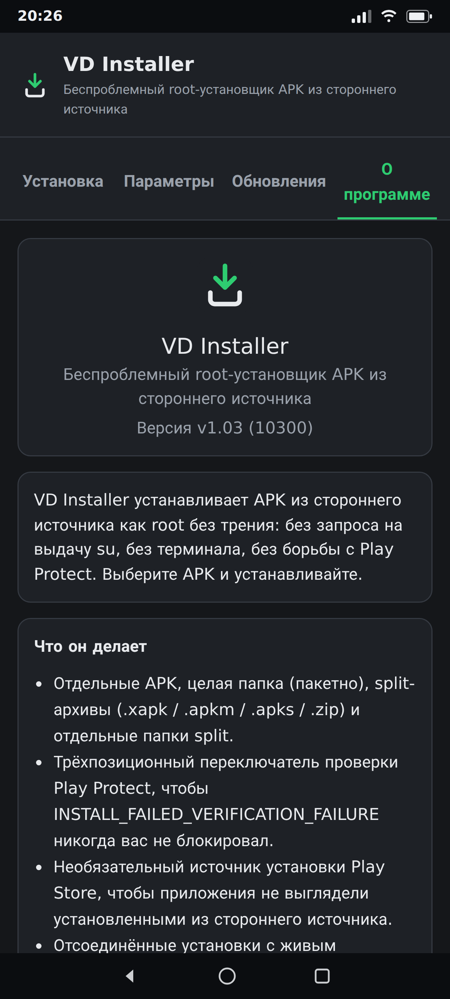

<!--
  ======================================================================
   VD INSTALLER  ::  frictionless root sideload installer
   Install sideload APKs as root (single/batch/split), no friction: KernelSU/APatch/Magisk WebUI.

   Copyright (C) 2026  VD171
   SPDX-License-Identifier: AGPL-3.0-or-later

   Free software under the GNU AGPL v3 or later. NETWORK COPYLEFT: run a
   modified version, even as a service, and you MUST offer its source.

   Site           : https://vd171.ru
   Site           : https://vd.priv8.ru
   Source         : https://github.com/VD171/VD-Installer
   GitHub         : @VD171 https://github.com/VD171
   XDA-Developers : @VD171 https://xdaforums.com/m/vd171.4699873/
   XDA thread     : https://xdaforums.com/t/VD-Installer.4809504/
   Telegram       : @VD_Priv8 https://t.me/VD_Priv8
   Channel        : @Priv8_VD https://t.me/Priv8_VD
   Discord        : @VD.Priv8 https://discord.com/users/1296831918989639721
   E-mail         : vd.priv8@pm.me
  ======================================================================
-->

> **Languages:** [English](README.md) · [العربية](README.ar.md) · [Čeština](README.cs.md) · [Deutsch](README.de.md) · [Español](README.es.md) · [فارسی](README.fa.md) · [Français](README.fr.md) · [हिन्दी](README.hi.md) · [Bahasa Indonesia](README.id.md) · [Italiano](README.it.md) · [日本語](README.ja.md) · [한국어](README.ko.md) · [Nederlands](README.nl.md) · [Polski](README.pl.md) · [Português](README.pt.md) · Русский · [Svenska](README.sv.md) · [ไทย](README.th.md) · [Türkçe](README.tr.md) · [Українська](README.uk.md) · [Tiếng Việt](README.vi.md) · [中文](README.zh.md)

  

  
  
  
  

  <a href="https://github.com/VD171/VD-Installer/releases">Releases</a> ·
  <a href="https://github.com/VD171/VD-Installer/wiki">Wiki</a> ·
  <a href="https://github.com/VD171/VD-Installer/wiki/USER-GUIDE">Руководство пользователя</a> ·
  <a href="https://github.com/VD171/VD-Installer/wiki/AI-AGENTS">ИИ-агенты</a> ·
  <a href="https://github.com/VD171/VD-Installer/wiki/ARCHITECTURE">Архитектура</a> ·
  <a href="https://github.com/VD171/VD-Installer/wiki/FILE-STRUCTURE">Структура файлов</a> ·
  <a href="https://github.com/VD171/VD-Installer/wiki/BINARIES">Бинарные файлы</a> ·
  <a href="CHANGELOG.md">История изменений</a> ·
  <a href="https://xdaforums.com/t/VD-Installer.4809504/">XDA thread</a>

# VD Installer

> Беспроблемный root-установщик APK из стороннего источника: KernelSU / APatch / Magisk WebUI.

## Снимки экрана

     

## Зачем

Установка сторонней APK на телефоне с root-правами шумнее, чем следовало бы: верификатор пакетов
Play Protect может выдать `INSTALL_FAILED_VERIFICATION_FAILURE`, split-приложения (`.xapk` / `.apkm` / `.apks`)
требуют ручного использования session API, а свежеустановленное приложение объявляет себя как "sideloaded"
каждому приложению, которое читает его источник установки. VDInstaller делает всё это за вас, уже как root,
без запроса "предоставить su" и без терминала.

## Возможности

- **Любая форма APK:** одиночный `.apk`, целая папка независимых APK (batch), сгруппированный архив
  split (`.xapk` / `.apkm` / `.apks` / `.zip`) или папка отдельных split-APK.
- **Никакой стены верификации:** 3-позиционный переключатель для верификатора пакетов Play Protect:
  оставить как было (отключить только на время установки, восстановить в точности), всегда включён
  или всегда отключён.
- **Честно о Developer Verification:** root-установка уже освобождена от андроидовской Developer
  Verification 2026 года, переключатель работает по мере возможности и так и говорит, это никогда
  не фиктивный тумблер.
- **Не "sideloaded":** по желанию представляет источник установки как Play Store, как установщика
  (в момент установки), так и инициатора (через правку `packages.xml` с учётом ABX).
- **Отсоединяемо и возобновляемо:** установки выполняются как отсоединённый root-процесс, закрытие
  WebUI никогда их не прерывает, а интерфейс повторно подключается по идентификатору операции.
- **Ваш выбор:** тестовые пакеты, предоставление всех разрешений времени выполнения,
  целевой пользователь, обход блокировки низкого целевого SDK: всё по желанию.
- **Офлайн, автономно, без перезагрузки:** модуль WebUI с встроенными бинарниками, пригоден к работе
  в тот же момент, когда прошит.

## ИИ-агенты

Этот проект приветствует участников в виде ИИ и агентов. Движок говорит в JSON через небольшой безголовый
контракт (`scripts/helper.sh <verb> <base64(JSON)>`), задокументированный в
[docs/AI-AGENTS.md](docs/AI-AGENTS.md), так что агент может выполнить любое действие, доступное WebUI, не
скрапьте WebUI. Патчи от ИИ оцениваются по той же планке проверки, что и любые другие.

## Установка

Прошейте zip в KernelSU, APatch или Magisk и откройте WebUI VDInstaller из вашего root-менеджера.
Установщик сохраняет только ABI вашего устройства и запускает обязательную проверку целостности `.sha256`
(прерывается при повреждённом или усечённом zip). Android 8.0 (API 26) или новее.

## Безопасность

VDInstaller работает как root и устанавливает выбранные вами APK, отключение верификатора пакетов на время
установки отключает антивирусное сканирование, поэтому устанавливайте только доверенные APK. Он никогда не
ослабляет безопасность устройства незаметно: верификатор по умолчанию восстанавливается в точности до
прежнего состояния и никогда не трогает вашу настройку HMA-OSS. Сообщайте о проблемах согласно
[SECURITY.md](SECURITY.md).

## Сборка

Всегда release, никогда debug. `.github/scripts/build_bin.sh` получает `jq` из apt-репозитория Termux
(с его замыканием разделяемых библиотек) и самостоятельные конвертеры `abx2xml` / `xml2abx`,
для всех четырёх ABI, каждый с `PROVENANCE.json`. Workflow release собирает прошиваемые zip-файлы,
записывает сопутствующие `.sha256`, заполняет `update.json` и публикует как `github-actions[bot]`.

## Инкрементальные обновления (VDLU)

VD Installer поставляется с движком **[VDLiveUpdate](https://github.com/VD171/VDLiveUpdate) (VDLU)** (встроен в `module/vdlu/`): модуль обновляет себя, скачивая только те
файлы, которые изменились (адресуемые по содержимому блобы + подписанный `manifest.json`), вместо повторной
загрузки всего `.zip`. **Усиленный** профиль: подпись ed25519 обязательна, а понижения версии блокируются,
полный `.zip` остаётся действительным как запасной вариант.

- **Только LIVE** (без перезагрузки): обновления применяются при следующей загрузке через `service.sh`, в фоне, и ничего не делают, когда ни один feed недоступен.
- **Состояние** в `/data/adb/vdinstaller/vdlu/`, вне модуля, поэтому оно переживает перепрошивку.
- **WebUI:** панель **Обновления** с всплывающим уведомлением о ходе выполнения и отменой, автоматическое обновление включается по желанию.

## Документация

Руководства находятся в [docs/](docs/) и зеркалируются в вики GitHub. См.
[docs/AI-AGENTS.md](docs/AI-AGENTS.md) для безголового контракта.

## Смотрите также

- **[COPG-VD](https://github.com/VD171/COPG-VD)**: глобальный спуфинг fingerprint устройства / Play Integrity, для всего устройства с областью действия на уровне приложений и WebUI.
- **[VDBackup](https://github.com/VD171/VD-Backup)**: полное резервное копирование и восстановление приложений и данных с правами root, полностью управляемое из WebUI.
- **[VD-dropbear](https://github.com/VD171/VD-dropbear)**: автономный SSH-демон с правами root (Dropbear).
- **[VDGoogle](https://github.com/VD171/VD-Google)**: ваши сервисы Google (RCS, Wallet, аттестации Play Integrity), прочитанные на вашем устройстве без интернета.
- **[VDInfos](https://github.com/VD171/VD-Infos)**: отладчик методов устройства, который читает каждый элемент всеми методами, способными его прочитать, и сравнивает их бок о бок.
- **[VDLiveUpdate](https://github.com/VD171/VDLiveUpdate)**: безфлешевый инкрементальный движок самообновления, встроенный в модули KernelSU/APatch/Magisk.
- **[VD-Modules](https://github.com/VD171/VD-Modules)**: наш репозиторий модулей MMRL/WebUI-X (установите их все из вашего root-менеджера).
- **[@VictorGabriel7Dev/build.prop](https://github.com/VictorGabriel7Dev/build.prop)**: набор данных fingerprint `build.prop` от Pixel (форк @T3SL4).
- **[@VictorGabriel7Dev/mtproto-store](https://github.com/VictorGabriel7Dev/mtproto-store)**: используйте Telegram как объектное хранилище из крошечного CLI на Go.

## Контакты

- https://vd171.ru
- https://vd.priv8.ru
- **Telegram:** @VD_Priv8 https://t.me/VD_Priv8
- **Channel:** @Priv8_VD https://t.me/Priv8_VD
- **Discord:** @VD.Priv8 https://discord.com/users/1296831918989639721
- **E-mail:** vd.priv8@pm.me
- **XDA-Developers:** @VD171 https://xdaforums.com/m/vd171.4699873/
- **XDA thread:** https://xdaforums.com/t/VD-Installer.4809504/
- **GitHub:** @VD171 https://github.com/VD171

## Лицензия

VDInstaller лицензирован под GNU AGPL-3.0-or-later. См. [LICENSE](LICENSE). NETWORK COPYLEFT:
запустите изменённую версию, даже как услугу, и вы обязаны предложить её исходный код.

## Товарные знаки

Android, KernelSU, APatch, Magisk, Google Play и Play Protect принадлежат их соответствующим владельцам.
Этот проект независим и не связан с ними и не одобрен ими.

## Теги

`android` `root` `kernelsu` `magisk` `apatch` `webui` `apk-installer` `sideload` `split-apk` `xapk` `vdinstaller`

---

📣 **Подпишитесь на канал для обновлений:** @Priv8_VD https://t.me/Priv8_VD
