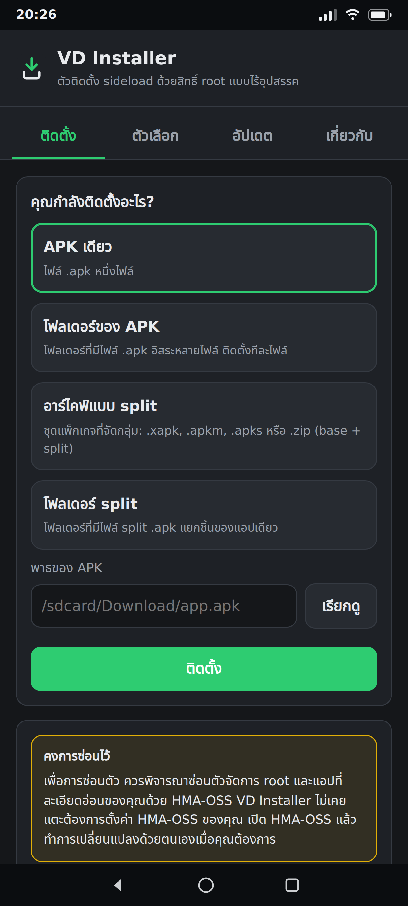
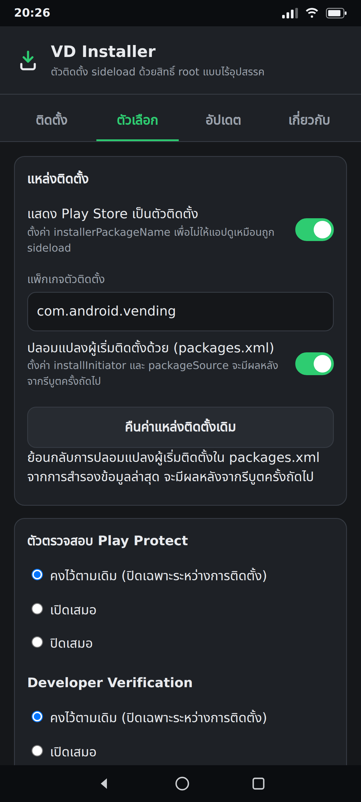
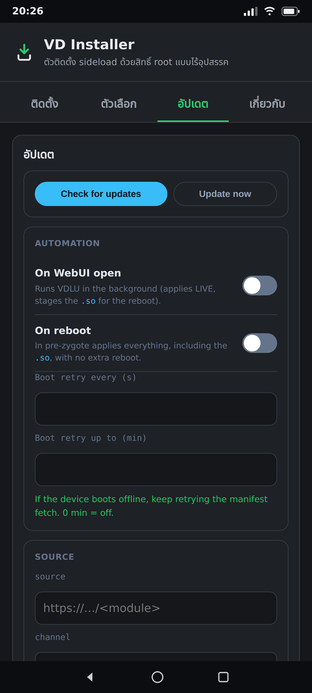
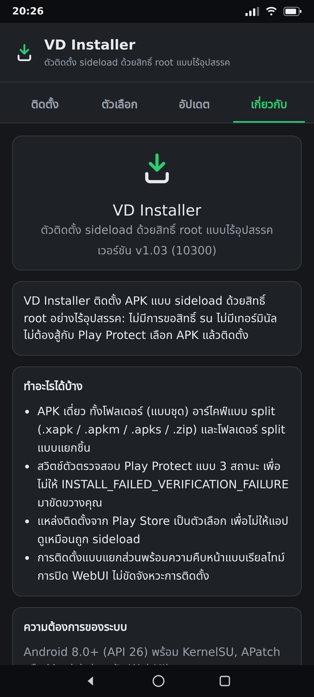

<!--
  ======================================================================
   VD INSTALLER  ::  frictionless root sideload installer
   Install sideload APKs as root (single/batch/split), no friction: KernelSU/APatch/Magisk WebUI.

   Copyright (C) 2026  VD171
   SPDX-License-Identifier: AGPL-3.0-or-later

   Free software under the GNU AGPL v3 or later. NETWORK COPYLEFT: run a
   modified version, even as a service, and you MUST offer its source.

   Site           : https://vd171.ru
   Site           : https://vd.priv8.ru
   Source         : https://github.com/VD171/VD-Installer
   GitHub         : @VD171 https://github.com/VD171
   XDA-Developers : @VD171 https://xdaforums.com/m/vd171.4699873/
   XDA thread     : https://xdaforums.com/t/VD-Installer.4809504/
   Telegram       : @VD_Priv8 https://t.me/VD_Priv8
   Channel        : @Priv8_VD https://t.me/Priv8_VD
   Discord        : @VD.Priv8 https://discord.com/users/1296831918989639721
   E-mail         : vd.priv8@pm.me
  ======================================================================
-->

> **Languages:** [English](README.md) · [العربية](README.ar.md) · [Čeština](README.cs.md) · [Deutsch](README.de.md) · [Español](README.es.md) · [فارسی](README.fa.md) · [Français](README.fr.md) · [हिन्दी](README.hi.md) · [Bahasa Indonesia](README.id.md) · [Italiano](README.it.md) · [日本語](README.ja.md) · [한국어](README.ko.md) · [Nederlands](README.nl.md) · [Polski](README.pl.md) · [Português](README.pt.md) · [Русский](README.ru.md) · [Svenska](README.sv.md) · ไทย · [Türkçe](README.tr.md) · [Українська](README.uk.md) · [Tiếng Việt](README.vi.md) · [中文](README.zh.md)

  

  
  
  
  

  <a href="https://github.com/VD171/VD-Installer/releases">Releases</a> ·
  <a href="https://github.com/VD171/VD-Installer/wiki">Wiki</a> ·
  <a href="https://github.com/VD171/VD-Installer/wiki/USER-GUIDE">คู่มือผู้ใช้</a> ·
  <a href="https://github.com/VD171/VD-Installer/wiki/AI-AGENTS">เอเจนต์ AI</a> ·
  <a href="https://github.com/VD171/VD-Installer/wiki/ARCHITECTURE">สถาปัตยกรรม</a> ·
  <a href="https://github.com/VD171/VD-Installer/wiki/FILE-STRUCTURE">โครงสร้างไฟล์</a> ·
  <a href="https://github.com/VD171/VD-Installer/wiki/BINARIES">ไบนารี</a> ·
  <a href="CHANGELOG.md">บันทึกการเปลี่ยนแปลง</a> ·
  <a href="https://xdaforums.com/t/VD-Installer.4809504/">XDA thread</a>

# VD Installer

> ตัวติดตั้ง sideload ด้วยสิทธิ์ root แบบไร้อุปสรรค: KernelSU / APatch / Magisk WebUI.

## ภาพหน้าจอ

     

## ทำไม

การติดตั้ง APK แบบ sideload บนโทรศัพท์ที่ root แล้วนั้นยุ่งยากกว่าที่ควรจะเป็น: ตัวตรวจสอบแพ็กเกจของ Play
Protect อาจแจ้ง `INSTALL_FAILED_VERIFICATION_FAILURE`, แอปแบบ split (`.xapk` / `.apkm` / `.apks`)
ต้องใช้ session API ด้วยมือ และแอปที่เพิ่งติดตั้งจะประกาศตัวเองว่าเป็น "sideload" ต่อทุกแอปที่อ่านแหล่งติดตั้งของมัน
VDInstaller ทำทั้งหมดนั้นให้คุณ โดยเป็น root อยู่แล้ว ไม่มีการขอ "อนุญาต su" และไม่มีเทอร์มินัล

## คุณสมบัติ

- **APK ทุกรูปแบบ:** ไฟล์ `.apk` เดียว, ทั้งโฟลเดอร์ของ APK อิสระ (แบบชุด), อาร์ไคฟ์ split ที่จัดกลุ่ม
  (`.xapk` / `.apkm` / `.apks` / `.zip`) หรือโฟลเดอร์ของ split APK ที่แยกชิ้น
- **ไม่มีกำแพงการตรวจสอบ:** สวิตช์ 3 สถานะสำหรับตัวตรวจสอบแพ็กเกจ Play Protect: คงไว้ตามเดิม
  (ปิดเฉพาะระหว่างการติดตั้ง แล้วคืนค่าตรงเป๊ะ), เปิดเสมอ หรือปิดเสมอ
- **ซื่อตรงเรื่อง Developer Verification:** การติดตั้งด้วย root ได้รับการยกเว้นจาก Android Developer
  Verification ปี 2026 อยู่แล้ว สวิตช์นี้เป็นความพยายามอย่างดีที่สุดและบอกเช่นนั้น ไม่ใช่สวิตช์หลอก
- **ไม่ใช่ "sideload":** สามารถเลือกแสดงแหล่งติดตั้งเป็น Play Store ได้ ทั้งตัวติดตั้ง (ขณะติดตั้ง)
  และผู้เริ่มติดตั้ง (ผ่านการแก้ไข `packages.xml` ที่รองรับ ABX)
- **แยกตัวและทำต่อได้:** การติดตั้งทำงานเป็นกระบวนการ root ที่แยกตัว การปิด WebUI ไม่เคยขัดจังหวะมัน
  และ UI จะเชื่อมต่อกลับด้วยหมายเลขการดำเนินการ
- **คุณเป็นผู้ตัดสิน:** แพ็กเกจทดสอบ, ให้สิทธิ์รันไทม์ทั้งหมด, ผู้ใช้เป้าหมาย, ข้ามการบล็อก
  target SDK ต่ำ: ทั้งหมดเป็นตัวเลือก
- **ออฟไลน์ สมบูรณ์ในตัว ไม่ต้องรีบูต:** โมดูล WebUI ที่มีไบนารีรวมมาด้วย ใช้งานได้ทันทีที่แฟลช

## เอเจนต์ AI

โปรเจกต์นี้ยินดีต้อนรับผู้ร่วมสนับสนุนที่เป็น AI และเอเจนต์ เอนจินสื่อสารด้วย JSON ผ่านสัญญา headless เล็ก ๆ
(`scripts/helper.sh <verb> <base64(JSON)>`) ซึ่งมีเอกสารอยู่ใน [docs/AI-AGENTS.md](docs/AI-AGENTS.md)
ดังนั้นเอเจนต์จึงสามารถสั่งการทุกการกระทำที่ WebUI ทำได้, อย่าสเครป WebUI แพตช์จาก AI
จะถูกพิจารณาด้วยมาตรฐานการรีวิวเดียวกันกับแพตช์อื่น ๆ

## การติดตั้ง

แฟลช zip ใน KernelSU, APatch หรือ Magisk แล้วเปิด WebUI ของ VDInstaller จากตัวจัดการ root ของคุณ
ตัวติดตั้งจะเก็บเฉพาะ ABI ของอุปกรณ์คุณ และรันด่านตรวจสอบความสมบูรณ์ `.sha256` ที่บังคับ (จะยกเลิกหาก zip
เสียหายหรือถูกตัดทอน) ต้องใช้ Android 8.0 (API 26) ขึ้นไป

## ความปลอดภัย

VDInstaller ทำงานเป็น root และติดตั้ง APK ที่คุณเลือก การปิดตัวตรวจสอบแพ็กเกจระหว่างการติดตั้งจะปิดการสแกน
มัลแวร์ ดังนั้นให้ติดตั้งเฉพาะ APK ที่คุณไว้วางใจ มันไม่เคยลดทอนความปลอดภัยของอุปกรณ์อย่างเงียบ ๆ:
โดยค่าเริ่มต้นตัวตรวจสอบจะถูกคืนค่าสู่สถานะเดิมอย่างแม่นยำ และไม่เคยแตะต้องการตั้งค่า HMA-OSS ของคุณ
รายงานปัญหาตาม [SECURITY.md](SECURITY.md)

## การสร้าง

release เสมอ ไม่เคย debug `.github/scripts/build_bin.sh` ดึง `jq` จากที่เก็บ apt ของ Termux
(พร้อมชุดไลบรารีที่ใช้ร่วมกัน) และตัวแปลง `abx2xml` / `xml2abx` แบบสแตนด์อะโลน สำหรับทั้งสี่ ABI
แต่ละตัวมี `PROVENANCE.json` เวิร์กโฟลว์การปล่อยจะประกอบ zip ที่แฟลชได้ เขียนไฟล์คู่ `.sha256`
เติม `update.json` และเผยแพร่ในชื่อ `github-actions[bot]`

## การอัปเดตแบบเพิ่มทีละส่วน (VDLU)

VD Installer มาพร้อมเอนจิน **[VDLiveUpdate](https://github.com/VD171/VDLiveUpdate) (VDLU)** (ฝังอยู่ใน `module/vdlu/`): โมดูลอัปเดตตัวเองโดยดึงเฉพาะไฟล์ที่เปลี่ยนแปลง (บล็อบแบบระบุที่อยู่ด้วยเนื้อหา + `manifest.json` ที่ลงนามแล้ว) แทนที่จะดาวน์โหลด `.zip` ทั้งก้อนใหม่. โปรไฟล์ **เสริมความแข็งแกร่ง**: ลายเซ็น ed25519 เป็นสิ่งบังคับและการดาวน์เกรดถูกบล็อก, `.zip` แบบเต็มยังคงใช้ได้ในฐานะทางเลือกสำรอง.

- **LIVE เท่านั้น** (ไม่ต้องรีบูต): การอัปเดตจะถูกนำไปใช้ในการบูตครั้งถัดไปผ่าน `service.sh` แบบเบื้องหลัง, ไม่ทำอะไรเลยเมื่อไม่มี feed ที่เข้าถึงได้.
- **สถานะ** อยู่ใน `/data/adb/vdinstaller/vdlu/`, ภายนอกโมดูล จึงอยู่รอดหลังการแฟลชใหม่.
- **WebUI:** แผง **อัปเดต** พร้อม toast แสดงความคืบหน้าและปุ่มยกเลิก, การอัปเดตอัตโนมัติเป็นแบบเลือกเปิดใช้ (opt-in).

## เอกสาร

คู่มืออยู่ใน [docs/](docs/) และมิเรอร์ไปยังวิกิ GitHub ดู [docs/AI-AGENTS.md](docs/AI-AGENTS.md)
สำหรับสัญญา headless

## ดูเพิ่มเติม

- **[COPG-VD](https://github.com/VD171/COPG-VD)**: การสปูฟ fingerprint ของอุปกรณ์ / Play Integrity แบบครอบคลุมทั้งเครื่อง พร้อมขอบเขตแยกตามแอปและ WebUI
- **[VDBackup](https://github.com/VD171/VD-Backup)**: สำรองและกู้คืนแอปและข้อมูลแบบเต็มรูปแบบในฐานะ root ควบคุมทั้งหมดจาก WebUI
- **[VD-dropbear](https://github.com/VD171/VD-dropbear)**: SSH daemon แบบสแตนด์อโลนที่ทำงานด้วยสิทธิ์ root (Dropbear)
- **[VDGoogle](https://github.com/VD171/VD-Google)**: บริการ Google ของคุณ (RCS, Wallet, การรับรอง Play Integrity) อ่านบนอุปกรณ์ของคุณโดยไม่ใช้อินเทอร์เน็ต
- **[VDInfos](https://github.com/VD171/VD-Infos)**: ตัวดีบักเมธอดของอุปกรณ์ที่อ่านแต่ละรายการผ่านทุกเมธอดที่สามารถอ่านได้ และนำมาเปรียบเทียบกันเคียงข้างกัน
- **[VDLiveUpdate](https://github.com/VD171/VDLiveUpdate)**: เอนจินอัปเดตตัวเองแบบเพิ่มทีละส่วนโดยไม่ต้องแฟลช ฝังอยู่ในโมดูล KernelSU/APatch/Magisk
- **[VD-Modules](https://github.com/VD171/VD-Modules)**: ที่เก็บโมดูล MMRL/WebUI-X ของเรา (ติดตั้งทั้งหมดได้จากตัวจัดการ root ของคุณ)
- **[@VictorGabriel7Dev/build.prop](https://github.com/VictorGabriel7Dev/build.prop)**: ชุดข้อมูล fingerprint `build.prop` ของ Pixel (ฟอร์กจาก @T3SL4)
- **[@VictorGabriel7Dev/mtproto-store](https://github.com/VictorGabriel7Dev/mtproto-store)**: ใช้ Telegram เป็น object store จาก Go CLI ขนาดเล็ก

## Contacts

- https://vd171.ru
- https://vd.priv8.ru
- **Telegram:** @VD_Priv8 https://t.me/VD_Priv8
- **Channel:** @Priv8_VD https://t.me/Priv8_VD
- **Discord:** @VD.Priv8 https://discord.com/users/1296831918989639721
- **E-mail:** vd.priv8@pm.me
- **XDA-Developers:** @VD171 https://xdaforums.com/m/vd171.4699873/
- **XDA thread:** https://xdaforums.com/t/VD-Installer.4809504/
- **GitHub:** @VD171 https://github.com/VD171

## สัญญาอนุญาต

VDInstaller ได้รับอนุญาตภายใต้ GNU AGPL-3.0-or-later ดู [LICENSE](LICENSE) NETWORK COPYLEFT:
หากคุณรันเวอร์ชันที่แก้ไข แม้จะเป็นบริการ คุณต้องเสนอซอร์สโค้ดของมัน

## เครื่องหมายการค้า

Android, KernelSU, APatch, Magisk, Google Play และ Play Protect เป็นของเจ้าของแต่ละราย
โปรเจกต์นี้เป็นอิสระ ไม่มีส่วนเกี่ยวข้องหรือได้รับการรับรองจากพวกเขา

## แท็ก

`android` `root` `kernelsu` `magisk` `apatch` `webui` `apk-installer` `sideload` `split-apk` `xapk` `vdinstaller`

---

📣 **เข้าร่วมช่องเพื่อรับการอัปเดต:** @Priv8_VD https://t.me/Priv8_VD
