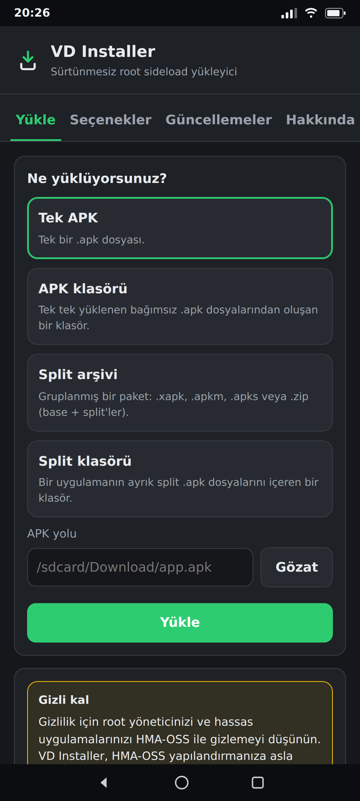
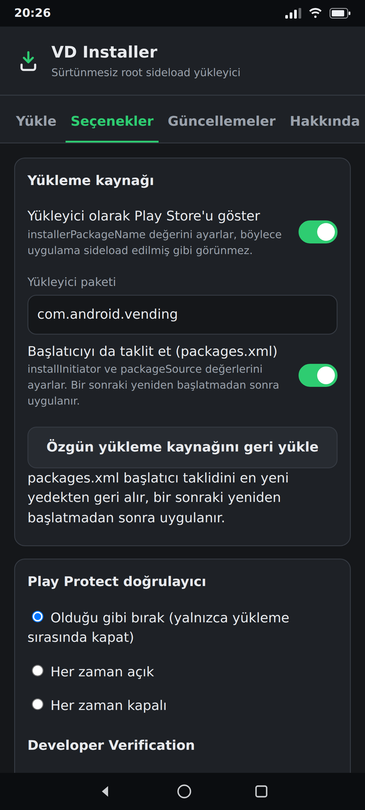
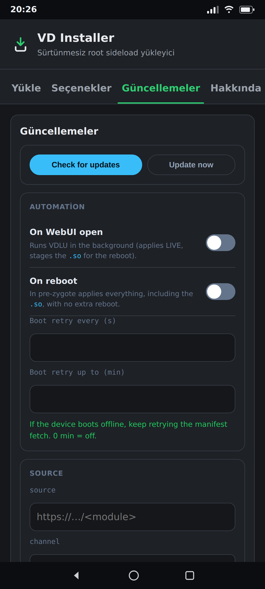
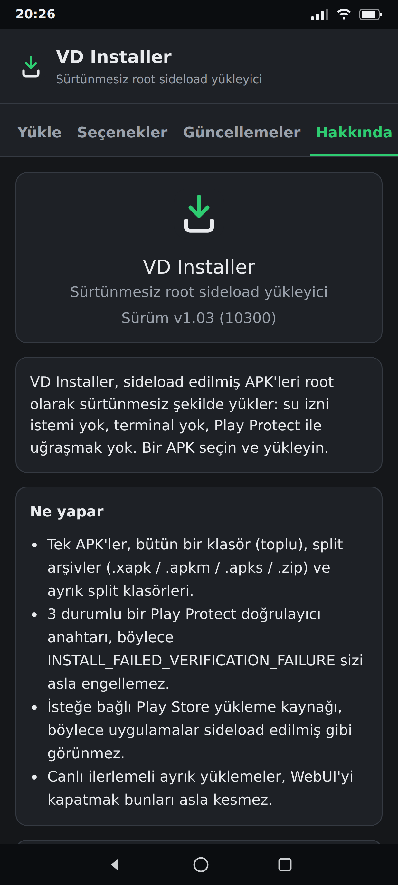

<!--
  ======================================================================
   VD INSTALLER  ::  frictionless root sideload installer
   Install sideload APKs as root (single/batch/split), no friction: KernelSU/APatch/Magisk WebUI.

   Copyright (C) 2026  VD171
   SPDX-License-Identifier: AGPL-3.0-or-later

   Free software under the GNU AGPL v3 or later. NETWORK COPYLEFT: run a
   modified version, even as a service, and you MUST offer its source.

   Site           : https://vd171.ru
   Site           : https://vd.priv8.ru
   Source         : https://github.com/VD171/VD-Installer
   GitHub         : @VD171 https://github.com/VD171
   XDA-Developers : @VD171 https://xdaforums.com/m/vd171.4699873/
   XDA thread     : https://xdaforums.com/t/VD-Installer.4809504/
   Telegram       : @VD_Priv8 https://t.me/VD_Priv8
   Channel        : @Priv8_VD https://t.me/Priv8_VD
   Discord        : @VD.Priv8 https://discord.com/users/1296831918989639721
   E-mail         : vd.priv8@pm.me
  ======================================================================
-->

> **Languages:** [English](README.md) · [العربية](README.ar.md) · [Čeština](README.cs.md) · [Deutsch](README.de.md) · [Español](README.es.md) · [فارسی](README.fa.md) · [Français](README.fr.md) · [हिन्दी](README.hi.md) · [Bahasa Indonesia](README.id.md) · [Italiano](README.it.md) · [日本語](README.ja.md) · [한국어](README.ko.md) · [Nederlands](README.nl.md) · [Polski](README.pl.md) · [Português](README.pt.md) · [Русский](README.ru.md) · [Svenska](README.sv.md) · [ไทย](README.th.md) · Türkçe · [Українська](README.uk.md) · [Tiếng Việt](README.vi.md) · [中文](README.zh.md)

  

  
  
  
  

  <a href="https://github.com/VD171/VD-Installer/releases">Releases</a> ·
  <a href="https://github.com/VD171/VD-Installer/wiki">Wiki</a> ·
  <a href="https://github.com/VD171/VD-Installer/wiki/USER-GUIDE">Kullanıcı kılavuzu</a> ·
  <a href="https://github.com/VD171/VD-Installer/wiki/AI-AGENTS">Yapay zeka araçları</a> ·
  <a href="https://github.com/VD171/VD-Installer/wiki/ARCHITECTURE">Mimari</a> ·
  <a href="https://github.com/VD171/VD-Installer/wiki/FILE-STRUCTURE">Dosya yapısı</a> ·
  <a href="https://github.com/VD171/VD-Installer/wiki/BINARIES">İkili dosyalar</a> ·
  <a href="CHANGELOG.md">Değişiklik günlüğü</a> ·
  <a href="https://xdaforums.com/t/VD-Installer.4809504/">XDA thread</a>

# VD Installer

> Sürtünmesiz root sideload yükleyici: KernelSU / APatch / Magisk WebUI.

## Ekran görüntüleri

     

## Neden

Root'lu bir telefona sideload edilmiş bir APK yüklemek olması gerekenden daha gürültülüdür: Play
Protect'in paket doğrulayıcısı `INSTALL_FAILED_VERIFICATION_FAILURE` hatası verebilir, split
uygulamalar (`.xapk` / `.apkm` / `.apks`) session API'sinin elle kullanılmasını gerektirir ve yeni
yüklenen bir uygulama, yükleme kaynağını okuyan her uygulamaya kendini "sideload edilmiş" olarak
tanıtır. VDInstaller tüm bunları sizin yerinize, zaten root olarak, "su izni ver" istemi ve terminal
olmadan yapar.

## Özellikler

- **Her APK biçimi:** tek bir `.apk`, bağımsız APK'lerden oluşan bir klasörün tamamı (toplu),
  gruplanmış bir split arşivi (`.xapk` / `.apkm` / `.apks` / `.zip`) ya da ayrık split APK'lerden
  oluşan bir klasör.
- **Doğrulama duvarı yok:** Play Protect paket doğrulayıcısı için 3 durumlu bir anahtar: olduğu
  gibi tut (yalnızca yükleme sırasında kapalı, tam olarak geri yüklenir), her zaman açık ya da her
  zaman kapalı.
- **Developer Verification konusunda dürüst:** bir root yüklemesi Android'in 2026 Developer
  Verification'ından zaten muaftır, anahtar elden geldiğince çalışır ve bunu söyler, asla sahte bir
  anahtar değildir.
- **"Sideload edilmiş" değil:** isteğe bağlı olarak yükleme kaynağını Play Store olarak gösterir,
  hem yükleyici (yükleme anında) hem de başlatıcı (ABX uyumlu bir `packages.xml` düzenlemesiyle).
- **Ayrık ve sürdürülebilir:** yüklemeler ayrık bir root süreci olarak çalışır, WebUI'yi kapatmak
  onları asla kesmez ve arayüz işlem kimliğiyle yeniden bağlanır.
- **Sizin kararınız:** test paketleri, tüm çalışma zamanı izinlerini verme, hedef
  kullanıcı, düşük hedef SDK engelini atlama: hepsi isteğe bağlı.
- **Çevrimdışı, kendi kendine yeterli, yeniden başlatma gerektirmez:** ikili dosyaları paketlenmiş
  bir WebUI modülü, flaşlandığı anda kullanılabilir.

## Yapay zekâ ajanları

Bu proje yapay zekâ ve ajan katkıcılarını memnuniyetle karşılar. Motor, [docs/AI-AGENTS.md](docs/AI-AGENTS.md)
içinde belgelenen küçük bir headless sözleşme (`scripts/helper.sh <verb> <base64(JSON)>`) üzerinden
JSON konuşur, böylece bir ajan, WebUI'nin yapabildiği her eylemi yürütebilir, WebUI'yi kazımayın.
Yapay zekâdan gelen yamalar, diğerleriyle aynı inceleme ölçütüne tabidir.

## Kurulum

Zip'i KernelSU, APatch veya Magisk'te flaşlayın ve root yöneticinizden VDInstaller WebUI'sini açın.
Yükleyici yalnızca cihazınızın ABI'sini tutar ve zorunlu `.sha256` bütünlük denetimini çalıştırır
(bozuk ya da kesik bir zip'te durur). Android 8.0 (API 26) veya daha yenisi.

## Güvenlik

VDInstaller root olarak çalışır ve seçtiğiniz APK'leri yükler, bir yükleme için paket doğrulayıcıyı
kapatmak bir kötü amaçlı yazılım taramasını devre dışı bırakır, bu yüzden yalnızca güvendiğiniz
APK'leri yükleyin. Cihaz güvenliğini asla sessizce zayıflatmaz: doğrulayıcı varsayılan olarak tam
önceki durumuna geri yüklenir ve HMA-OSS yapılandırmanıza asla dokunmaz. Sorunları
[SECURITY.md](SECURITY.md) uyarınca bildirin.

## Derleme

Her zaman release, asla debug. `.github/scripts/build_bin.sh`, `jq`'yu Termux apt deposundan
(paylaşılan kütüphane kapanışıyla birlikte) ve bağımsız `abx2xml` / `xml2abx` dönüştürücülerini,
dört ABI'nin tamamı için, her biri bir `PROVENANCE.json` ile birlikte getirir. Release iş akışı
flaşlanabilir zip'leri derler, `.sha256` eşlerini yazar, `update.json`'ı doldurur ve
`github-actions[bot]` olarak yayımlar.

## Artımlı güncellemeler (VDLU)

VD Installer, **[VDLiveUpdate](https://github.com/VD171/VDLiveUpdate) (VDLU)** motorunu içerir (`module/vdlu/` içine gömülü): modül, tüm `.zip` dosyasını yeniden indirmek
yerine yalnızca değişen dosyaları (içerik adresli bloblar + imzalı bir `manifest.json`) alarak kendini
günceller. **Sağlamlaştırılmış** profil: ed25519 imzası zorunludur ve sürüm düşürmeleri engellenir, tam
`.zip` bir yedek olarak geçerli kalır.

- **Yalnızca LIVE** (yeniden başlatma yok): güncellemeler bir sonraki açılışta `service.sh` ile arka planda uygulanır, erişilebilir bir feed yoksa hiçbir şey yapılmaz.
- **Durum** `/data/adb/vdinstaller/vdlu/` içinde, modülün dışında, böylece yeniden flashlamayı atlatır.
- **WebUI:** ilerleme bildirimi (toast) ve iptal içeren bir **Güncellemeler** paneli, otomatik güncelleme isteğe bağlıdır.

## Belgeler

Kılavuzlar [docs/](docs/) içinde bulunur ve GitHub wiki'sine yansıtılır. Headless sözleşme için
[docs/AI-AGENTS.md](docs/AI-AGENTS.md) dosyasına bakın.

## Ayrıca bakınız

- **[COPG-VD](https://github.com/VD171/COPG-VD)**: global cihaz fingerprint / Play Integrity sahteleme, uygulama bazlı kapsam ve bir WebUI ile tüm cihazda.
- **[VDBackup](https://github.com/VD171/VD-Backup)**: root olarak tam uygulama ve veri yedekleme ve geri yükleme, tamamen bir WebUI'den yönetilir.
- **[VD-dropbear](https://github.com/VD171/VD-dropbear)**: root olarak çalışan bağımsız bir SSH arka plan hizmeti (Dropbear).
- **[VDGoogle](https://github.com/VD171/VD-Google)**: Google hizmetleriniz (RCS, Wallet, Play Integrity doğrulamaları), internet olmadan cihazınızda okunur.
- **[VDInfos](https://github.com/VD171/VD-Infos)**: her bir ögeyi onu okuyabilen her yöntemle okuyup yan yana karşılaştıran bir cihaz yöntemi hata ayıklayıcısı.
- **[VDLiveUpdate](https://github.com/VD171/VDLiveUpdate)**: KernelSU/APatch/Magisk modüllerine gömülü, flash'sız, artımlı bir kendini güncelleme motoru.
- **[VD-Modules](https://github.com/VD171/VD-Modules)**: MMRL/WebUI-X modül deposumuz (hepsini root yöneticinizden kurun).
- **[@VictorGabriel7Dev/build.prop](https://github.com/VictorGabriel7Dev/build.prop)**: Pixel `build.prop` fingerprint'lerinden oluşan bir veri kümesi (@T3SL4 fork'u).
- **[@VictorGabriel7Dev/mtproto-store](https://github.com/VictorGabriel7Dev/mtproto-store)**: Telegram'ı minik bir Go CLI'sinden nesne deposu olarak kullanın.

## Contacts

- https://vd171.ru
- https://vd.priv8.ru
- **Telegram:** @VD_Priv8 https://t.me/VD_Priv8
- **Channel:** @Priv8_VD https://t.me/Priv8_VD
- **Discord:** @VD.Priv8 https://discord.com/users/1296831918989639721
- **E-mail:** vd.priv8@pm.me
- **XDA-Developers:** @VD171 https://xdaforums.com/m/vd171.4699873/
- **XDA thread:** https://xdaforums.com/t/VD-Installer.4809504/
- **GitHub:** @VD171 https://github.com/VD171

## Lisans

VDInstaller, GNU AGPL-3.0-or-later lisansı altında lisanslanmıştır. Bkz. [LICENSE](LICENSE). AĞ
COPYLEFT: değiştirilmiş bir sürümü, bir hizmet olarak bile çalıştırırsanız, kaynağını sunmanız
gerekir.

## Ticari markalar

Android, KernelSU, APatch, Magisk, Google Play ve Play Protect ilgili sahiplerine aittir. Bu proje
bağımsızdır ve onlarla bağlantılı değildir ya da onlar tarafından onaylanmamıştır.

## Etiketler

`android` `root` `kernelsu` `magisk` `apatch` `webui` `apk-installer` `sideload` `split-apk` `xapk` `vdinstaller`

---

📣 **Güncellemeler için kanala katılın:** @Priv8_VD https://t.me/Priv8_VD
