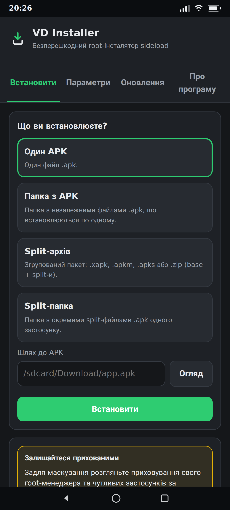
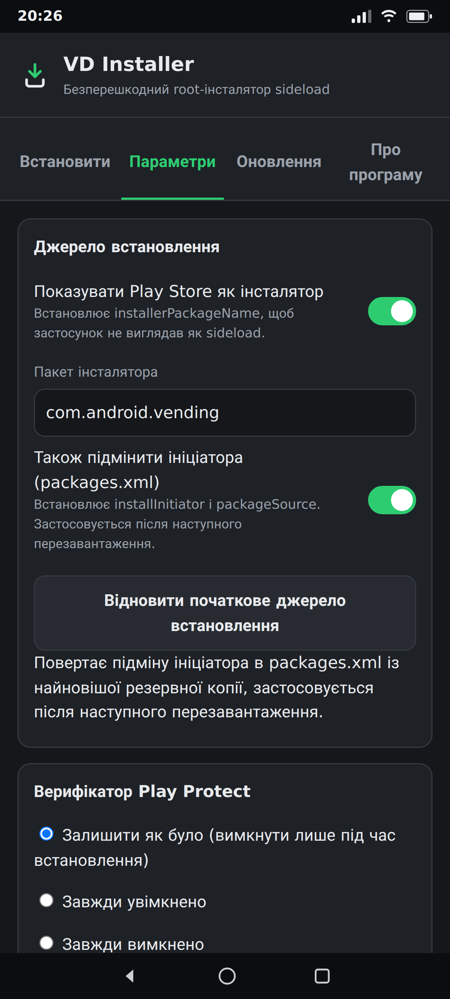
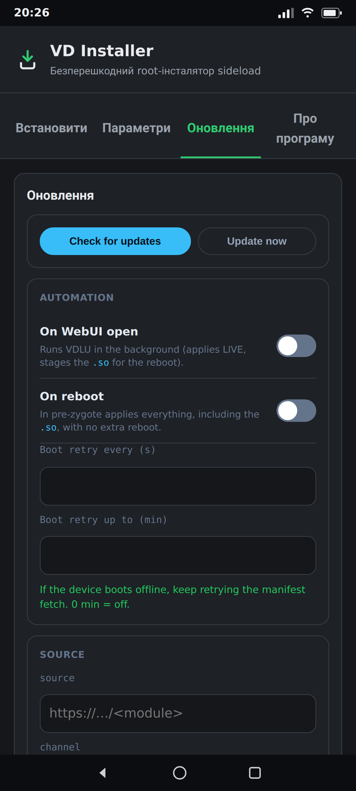
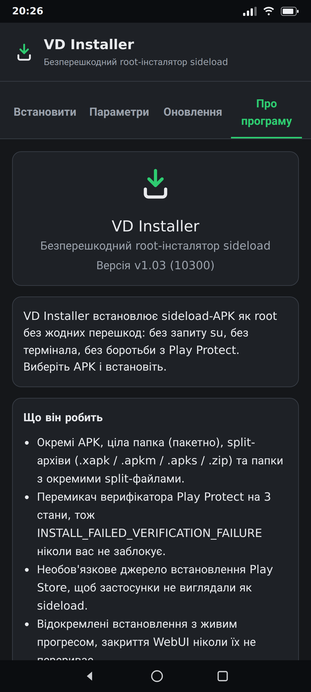

<!--
  ======================================================================
   VD INSTALLER  ::  frictionless root sideload installer
   Install sideload APKs as root (single/batch/split), no friction: KernelSU/APatch/Magisk WebUI.

   Copyright (C) 2026  VD171
   SPDX-License-Identifier: AGPL-3.0-or-later

   Free software under the GNU AGPL v3 or later. NETWORK COPYLEFT: run a
   modified version, even as a service, and you MUST offer its source.

   Site           : https://vd171.ru
   Site           : https://vd.priv8.ru
   Source         : https://github.com/VD171/VD-Installer
   GitHub         : @VD171 https://github.com/VD171
   XDA-Developers : @VD171 https://xdaforums.com/m/vd171.4699873/
   XDA thread     : https://xdaforums.com/t/VD-Installer.4809504/
   Telegram       : @VD_Priv8 https://t.me/VD_Priv8
   Channel        : @Priv8_VD https://t.me/Priv8_VD
   Discord        : @VD.Priv8 https://discord.com/users/1296831918989639721
   E-mail         : vd.priv8@pm.me
  ======================================================================
-->

> **Languages:** [English](README.md) · [العربية](README.ar.md) · [Čeština](README.cs.md) · [Deutsch](README.de.md) · [Español](README.es.md) · [فارسی](README.fa.md) · [Français](README.fr.md) · [हिन्दी](README.hi.md) · [Bahasa Indonesia](README.id.md) · [Italiano](README.it.md) · [日本語](README.ja.md) · [한국어](README.ko.md) · [Nederlands](README.nl.md) · [Polski](README.pl.md) · [Português](README.pt.md) · [Русский](README.ru.md) · [Svenska](README.sv.md) · [ไทย](README.th.md) · [Türkçe](README.tr.md) · Українська · [Tiếng Việt](README.vi.md) · [中文](README.zh.md)

  

  
  
  
  

  <a href="https://github.com/VD171/VD-Installer/releases">Releases</a> ·
  <a href="https://github.com/VD171/VD-Installer/wiki">Wiki</a> ·
  <a href="https://github.com/VD171/VD-Installer/wiki/USER-GUIDE">Посібник користувача</a> ·
  <a href="https://github.com/VD171/VD-Installer/wiki/AI-AGENTS">Агенти ШІ</a> ·
  <a href="https://github.com/VD171/VD-Installer/wiki/ARCHITECTURE">Архітектура</a> ·
  <a href="https://github.com/VD171/VD-Installer/wiki/FILE-STRUCTURE">Структура файлів</a> ·
  <a href="https://github.com/VD171/VD-Installer/wiki/BINARIES">Бінарні файли</a> ·
  <a href="CHANGELOG.md">Changelog</a> ·
  <a href="https://xdaforums.com/t/VD-Installer.4809504/">XDA thread</a>

# VD Installer

> Безперешкодний root-інсталятор sideload: KernelSU / APatch / Magisk WebUI.

## Знімки екрана

     

## Навіщо

Встановлення sideload-APK на root-телефоні створює більше шуму, ніж мало б: верифікатор пакунків
Play Protect може видати `INSTALL_FAILED_VERIFICATION_FAILURE`, split-застосунки (`.xapk` / `.apkm`
/ `.apks`) потребують ручного використання session API, а щойно встановлений застосунок оголошує
себе "sideload" кожному застосунку, що читає джерело його встановлення. VDInstaller робить усе це за
вас, уже як root, без запиту "надати su" і без термінала.

## Можливості

- **Будь-яка форма APK:** окремий `.apk`, ціла папка незалежних APK (пакетно), згрупований
  split-архів (`.xapk` / `.apkm` / `.apks` / `.zip`) або папка окремих split-APK.
- **Жодної стіни верифікації:** перемикач на 3 стани для верифікатора пакунків Play Protect:
  залишити як було (вимкнено лише під час встановлення, відновлюється точно), завжди увімкнено або
  завжди вимкнено.
- **Чесно щодо Developer Verification:** root-встановлення вже звільнене від Android Developer
  Verification 2026 року, перемикач працює за найкращих зусиль і каже про це, він ніколи не є
  фальшивим.
- **Не "sideload":** за бажанням подає джерело встановлення як Play Store, як інсталятора (під час
  встановлення), так і ініціатора (через ABX-сумісне редагування `packages.xml`).
- **Відокремлене й відновлюване:** встановлення виконуються як відокремлений root-процес, закриття
  WebUI ніколи їх не перериває, а інтерфейс повторно під'єднується за ідентифікатором операції.
- **Ваше рішення:** тестові пакунки, надання всіх дозволів часу виконання,
  цільовий користувач, обхід блокування низького цільового SDK: усе необов'язкове.
- **Офлайн, самодостатній, без перезавантаження:** WebUI-модуль із вбудованими двійковими файлами,
  придатний до використання одразу після прошивки.

## Агенти ШІ

Цей проєкт вітає внески ШІ та агентів. Рушій спілкується у форматі JSON через невеликий
headless-контракт (`scripts/helper.sh <verb> <base64(JSON)>`), задокументований у
[docs/AI-AGENTS.md](docs/AI-AGENTS.md), тож агент може виконувати будь-яку дію, доступну WebUI, не
скрейпте WebUI. Патчі від ШІ проходять ту саму планку рецензування, що й будь-які інші.

## Встановлення

Прошийте zip у KernelSU, APatch або Magisk і відкрийте WebUI VDInstaller зі свого root-менеджера.
Інсталятор зберігає лише ABI вашого пристрою й виконує обов'язкову перевірку цілісності `.sha256`
(перериває роботу на пошкодженому чи обрізаному zip). Android 8.0 (API 26) або новіший.

## Безпека

VDInstaller працює як root і встановлює вибрані вами APK, вимкнення верифікатора пакунків для
встановлення вимикає сканування на шкідливе ПЗ, тож встановлюйте лише APK, яким довіряєте. Він
ніколи не послаблює безпеку пристрою потайки: за замовчуванням верифікатор відновлюється до точного
попереднього стану, і він ніколи не торкається вашого налаштування HMA-OSS. Повідомляйте про
проблеми згідно з [SECURITY.md](SECURITY.md).

## Збирання

Завжди release, ніколи debug. `.github/scripts/build_bin.sh` отримує `jq` зі сховища apt Termux
(разом із замиканням спільних бібліотек) і автономні конвертери `abx2xml` / `xml2abx` для всіх
чотирьох ABI, кожен із `PROVENANCE.json`. Робочий процес випуску збирає прошивані zip, записує
супутні `.sha256`, заповнює `update.json` і публікує як `github-actions[bot]`.

## Інкрементні оновлення (VDLU)

VD Installer постачається з рушієм **[VDLiveUpdate](https://github.com/VD171/VDLiveUpdate) (VDLU)** (вбудований у `module/vdlu/`): модуль оновлює себе, завантажуючи лише ті
файли, що змінилися (адресовані за вмістом блоби + підписаний `manifest.json`), замість повторного
завантаження всього `.zip`. **Посилений** профіль: підпис ed25519 обов'язковий, а пониження версії
блокуються, повний `.zip` залишається дійсним як запасний варіант.

- **Лише LIVE** (без перезавантаження): оновлення застосовуються під час наступного завантаження через `service.sh`, у фоні, і нічого не роблять, коли жоден feed недоступний.
- **Стан** у `/data/adb/vdinstaller/vdlu/`, поза модулем, тож він переживає перепрошивку.
- **WebUI:** панель **Оновлення** зі спливним сповіщенням про прогрес і скасуванням, автоматичне оновлення вмикається за бажанням.

## Документація

Посібники розташовані в [docs/](docs/) і дзеркаляться до вікі GitHub. Див.
[docs/AI-AGENTS.md](docs/AI-AGENTS.md) щодо headless-контракту.

## Див. також

- **[COPG-VD](https://github.com/VD171/COPG-VD)**: глобальний спуфінг fingerprint пристрою / Play Integrity, для всього пристрою з областю дії на рівні застосунків і WebUI.
- **[VDBackup](https://github.com/VD171/VD-Backup)**: повне резервне копіювання та відновлення застосунків і даних з правами root, кероване повністю з WebUI.
- **[VD-dropbear](https://github.com/VD171/VD-dropbear)**: автономний SSH-демон із правами root (Dropbear).
- **[VDGoogle](https://github.com/VD171/VD-Google)**: ваші сервіси Google (RCS, Wallet, атестації Play Integrity), прочитані на вашому пристрої без інтернету.
- **[VDInfos](https://github.com/VD171/VD-Infos)**: налагоджувач методів пристрою, що читає кожен елемент через кожен метод, який може його прочитати, і порівнює їх пліч-о-пліч.
- **[VDLiveUpdate](https://github.com/VD171/VDLiveUpdate)**: безфлешевий інкрементальний рушій самооновлення, вбудований у модулі KernelSU/APatch/Magisk.
- **[VD-Modules](https://github.com/VD171/VD-Modules)**: наш репозиторій модулів MMRL/WebUI-X (встановіть їх усі зі свого root-менеджера).
- **[@VictorGabriel7Dev/build.prop](https://github.com/VictorGabriel7Dev/build.prop)**: набір даних fingerprint `build.prop` від Pixel (форк @T3SL4).
- **[@VictorGabriel7Dev/mtproto-store](https://github.com/VictorGabriel7Dev/mtproto-store)**: використовуйте Telegram як об'єктне сховище з крихітного CLI на Go.

## Contacts

- https://vd171.ru
- https://vd.priv8.ru
- **Telegram:** @VD_Priv8 https://t.me/VD_Priv8
- **Channel:** @Priv8_VD https://t.me/Priv8_VD
- **Discord:** @VD.Priv8 https://discord.com/users/1296831918989639721
- **E-mail:** vd.priv8@pm.me
- **XDA-Developers:** @VD171 https://xdaforums.com/m/vd171.4699873/
- **XDA thread:** https://xdaforums.com/t/VD-Installer.4809504/
- **GitHub:** @VD171 https://github.com/VD171

## Ліцензія

VDInstaller ліцензовано за GNU AGPL-3.0-or-later. Див. [LICENSE](LICENSE). МЕРЕЖЕВИЙ COPYLEFT: якщо
ви запускаєте змінену версію, навіть як службу, ви повинні надати її джерельний код.

## Торгові марки

Android, KernelSU, APatch, Magisk, Google Play і Play Protect належать відповідним власникам. Цей
проєкт є незалежним і не пов'язаний з ними та не схвалений ними.

## Теги

`android` `root` `kernelsu` `magisk` `apatch` `webui` `apk-installer` `sideload` `split-apk` `xapk` `vdinstaller`

---

📣 **Приєднуйтесь до каналу для оновлень:** @Priv8_VD https://t.me/Priv8_VD
