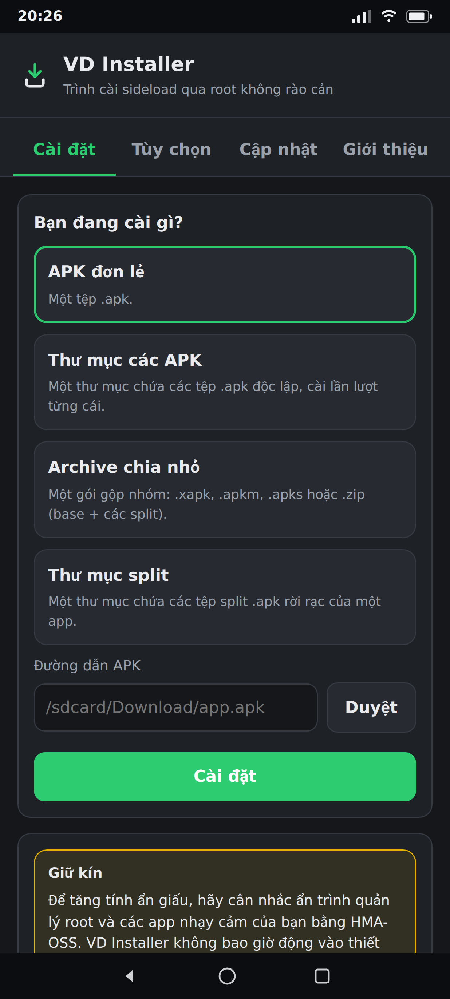
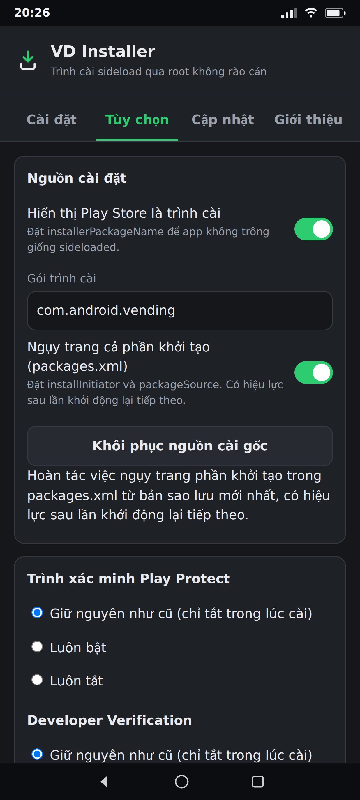
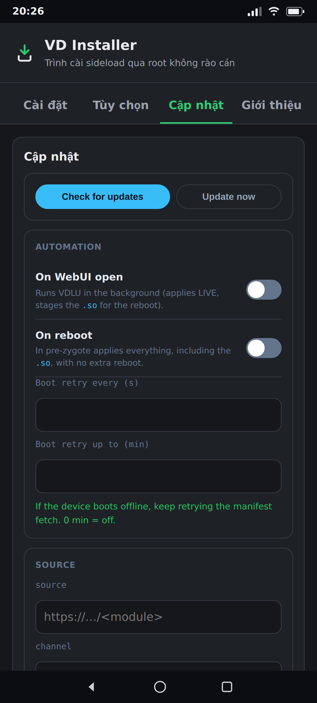
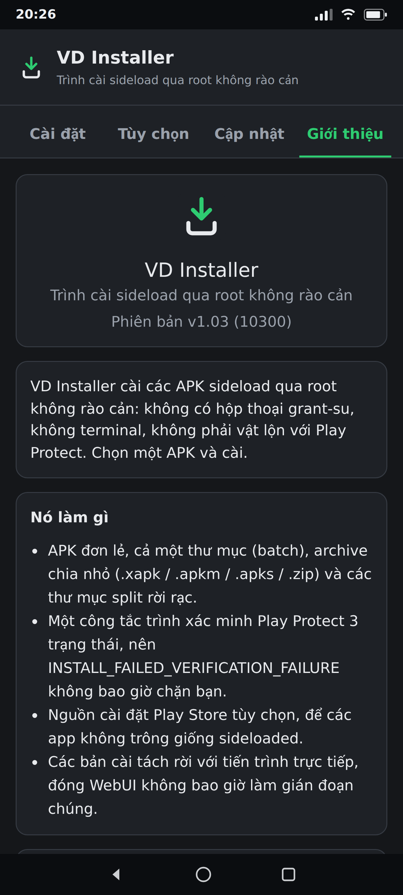

<!--
  ======================================================================
   VD INSTALLER  ::  frictionless root sideload installer
   Install sideload APKs as root (single/batch/split), no friction: KernelSU/APatch/Magisk WebUI.

   Copyright (C) 2026  VD171
   SPDX-License-Identifier: AGPL-3.0-or-later

   Free software under the GNU AGPL v3 or later. NETWORK COPYLEFT: run a
   modified version, even as a service, and you MUST offer its source.

   Site           : https://vd171.ru
   Site           : https://vd.priv8.ru
   Source         : https://github.com/VD171/VD-Installer
   GitHub         : @VD171 https://github.com/VD171
   XDA-Developers : @VD171 https://xdaforums.com/m/vd171.4699873/
   XDA thread     : https://xdaforums.com/t/VD-Installer.4809504/
   Telegram       : @VD_Priv8 https://t.me/VD_Priv8
   Channel        : @Priv8_VD https://t.me/Priv8_VD
   Discord        : @VD.Priv8 https://discord.com/users/1296831918989639721
   E-mail         : vd.priv8@pm.me
  ======================================================================
-->

> **Languages:** [English](README.md) · [العربية](README.ar.md) · [Čeština](README.cs.md) · [Deutsch](README.de.md) · [Español](README.es.md) · [فارسی](README.fa.md) · [Français](README.fr.md) · [हिन्दी](README.hi.md) · [Bahasa Indonesia](README.id.md) · [Italiano](README.it.md) · [日本語](README.ja.md) · [한국어](README.ko.md) · [Nederlands](README.nl.md) · [Polski](README.pl.md) · [Português](README.pt.md) · [Русский](README.ru.md) · [Svenska](README.sv.md) · [ไทย](README.th.md) · [Türkçe](README.tr.md) · [Українська](README.uk.md) · Tiếng Việt · [中文](README.zh.md)

  

  
  
  
  

  <a href="https://github.com/VD171/VD-Installer/releases">Releases</a> ·
  <a href="https://github.com/VD171/VD-Installer/wiki">Wiki</a> ·
  <a href="https://github.com/VD171/VD-Installer/wiki/USER-GUIDE">Hướng dẫn người dùng</a> ·
  <a href="https://github.com/VD171/VD-Installer/wiki/AI-AGENTS">Tác nhân AI</a> ·
  <a href="https://github.com/VD171/VD-Installer/wiki/ARCHITECTURE">Kiến trúc</a> ·
  <a href="https://github.com/VD171/VD-Installer/wiki/FILE-STRUCTURE">Cấu trúc tệp</a> ·
  <a href="https://github.com/VD171/VD-Installer/wiki/BINARIES">Tệp nhị phân</a> ·
  <a href="CHANGELOG.md">Nhật ký thay đổi</a> ·
  <a href="https://xdaforums.com/t/VD-Installer.4809504/">XDA thread</a>

# VD Installer

> Trình cài sideload qua root không rào cản: KernelSU / APatch / Magisk WebUI.

## Ảnh chụp màn hình

     

## Tại sao

Cài một APK sideload trên điện thoại đã root ồn ào hơn mức cần thiết: trình xác minh gói của Play Protect
có thể ném ra `INSTALL_FAILED_VERIFICATION_FAILURE`, các app chia nhỏ (`.xapk` / `.apkm` / `.apks`)
cần dùng session API bằng tay, và một app vừa cài sẽ tự khai là "sideloaded" với mọi app đọc nguồn cài
đặt của nó. VDInstaller làm tất cả những việc đó thay bạn, đã sẵn ở chế độ root, không có lời nhắc
"grant su" và không cần terminal.

## Tính năng

- **Mọi hình thức APK:** một `.apk` đơn lẻ, cả một thư mục các APK độc lập (batch), một archive chia
  nhỏ theo nhóm (`.xapk` / `.apkm` / `.apks` / `.zip`), hoặc một thư mục chứa các split APK rời rạc.
- **Không còn bức tường xác minh:** một công tắc 3 trạng thái cho trình xác minh gói của Play Protect:
  giữ nguyên như cũ (chỉ tắt trong lúc cài, rồi khôi phục chính xác), luôn bật, hoặc luôn tắt.
- **Trung thực về Developer Verification:** một bản cài qua root vốn đã được miễn trừ khỏi Developer
  Verification 2026 của Android, công tắc này chỉ là nỗ lực tối đa và nói rõ điều đó, không bao giờ là một
  nút giả.
- **Không phải "sideloaded":** tùy chọn trình bày nguồn cài đặt là Play Store, cả phần trình cài (lúc
  cài) lẫn phần khởi tạo (qua một chỉnh sửa `packages.xml` có nhận biết ABX).
- **Tách rời và có thể tiếp tục:** các bản cài chạy như một tiến trình root tách rời, đóng WebUI không
  bao giờ làm gián đoạn chúng, và giao diện gắn kết lại theo operation id.
- **Bạn quyết định:** gói test, cấp mọi quyền runtime, người dùng đích, bỏ qua chặn target
  SDK thấp: tất cả đều tùy chọn.
- **Offline, tự chứa đủ, không cần khởi động lại:** một module WebUI với các binary đóng kèm, dùng được
  ngay khi vừa flash.

## Tác nhân AI

Dự án này chào đón những người đóng góp là AI và tác nhân. Engine nói JSON qua một hợp đồng headless nhỏ
(`scripts/helper.sh <verb> <base64(JSON)>`), được mô tả trong
[docs/AI-AGENTS.md](docs/AI-AGENTS.md), nên một tác nhân có thể điều khiển mọi hành động mà WebUI làm
được, đừng scrape WebUI. Các bản vá từ AI được đánh giá theo cùng tiêu chuẩn review như bất kỳ đóng góp
nào khác.

## Cài đặt

Flash tệp zip trong KernelSU, APatch hoặc Magisk và mở WebUI của VDInstaller từ trình quản lý root của
bạn. Trình cài chỉ giữ lại ABI của thiết bị bạn và chạy cổng kiểm tra toàn vẹn `.sha256` bắt buộc
(hủy khi zip bị hỏng hoặc bị cắt cụt). Android 8.0 (API 26) trở lên.

## Bảo mật

VDInstaller chạy ở chế độ root và cài những APK bạn chọn, tắt trình xác minh gói cho một bản cài sẽ vô
hiệu hóa một lần quét mã độc, nên chỉ cài những APK bạn tin tưởng. Nó không bao giờ âm thầm làm yếu đi
bảo mật thiết bị: theo mặc định trình xác minh được khôi phục về đúng trạng thái trước đó, và nó không
bao giờ động vào thiết lập HMA-OSS của bạn. Báo lỗi theo [SECURITY.md](SECURITY.md).

## Build

Luôn release, không bao giờ debug. `.github/scripts/build_bin.sh` lấy `jq` từ kho apt Termux (cùng
với bề mặt thư viện chia sẻ của nó) và các trình chuyển đổi `abx2xml` / `xml2abx` độc lập, cho cả bốn
ABI, mỗi cái kèm một `PROVENANCE.json`. Workflow release lắp ráp các zip flash được, ghi các bản đồng
hành `.sha256`, điền `update.json` và phát hành dưới danh nghĩa `github-actions[bot]`.

## Cập nhật tăng dần (VDLU)

VD Installer đi kèm engine **[VDLiveUpdate](https://github.com/VD171/VDLiveUpdate) (VDLU)** (được nhúng trong `module/vdlu/`): mô-đun tự cập nhật bằng cách chỉ tải về những
tệp đã thay đổi (các blob định địa chỉ theo nội dung + một `manifest.json` đã ký), thay vì tải lại toàn bộ
`.zip`. Hồ sơ **được gia cố**: chữ ký ed25519 là bắt buộc và việc hạ cấp bị chặn, `.zip` đầy đủ vẫn hợp lệ
như một phương án dự phòng.

- **Chỉ LIVE** (không khởi động lại): các bản cập nhật được áp dụng ở lần khởi động kế tiếp qua `service.sh`, chạy nền, không làm gì khi không có feed nào truy cập được.
- **Trạng thái** trong `/data/adb/vdinstaller/vdlu/`, bên ngoài mô-đun, nên nó sống sót qua một lần flash lại.
- **WebUI:** một bảng **Cập nhật** với toast tiến trình và nút hủy, tự động cập nhật là tùy chọn (opt-in).

## Tài liệu

Các hướng dẫn nằm trong [docs/](docs/) và được mirror sang GitHub wiki. Xem
[docs/AI-AGENTS.md](docs/AI-AGENTS.md) để biết hợp đồng headless.

## Xem thêm

- **[COPG-VD](https://github.com/VD171/COPG-VD)**: giả mạo fingerprint thiết bị / Play Integrity toàn cục, trên toàn thiết bị với phạm vi theo từng ứng dụng và một WebUI.
- **[VDBackup](https://github.com/VD171/VD-Backup)**: sao lưu và khôi phục toàn bộ ứng dụng và dữ liệu với quyền root, điều khiển hoàn toàn từ WebUI.
- **[VD-dropbear](https://github.com/VD171/VD-dropbear)**: một SSH daemon độc lập chạy với quyền root (Dropbear).
- **[VDGoogle](https://github.com/VD171/VD-Google)**: các dịch vụ Google của bạn (RCS, Wallet, chứng thực Play Integrity), đọc trên thiết bị của bạn mà không cần internet.
- **[VDInfos](https://github.com/VD171/VD-Infos)**: một trình gỡ lỗi phương thức thiết bị, đọc từng mục qua mọi phương thức có thể đọc được nó và so sánh chúng cạnh nhau.
- **[VDLiveUpdate](https://github.com/VD171/VDLiveUpdate)**: một engine tự cập nhật tăng dần không cần flash, được nhúng vào các module KernelSU/APatch/Magisk.
- **[VD-Modules](https://github.com/VD171/VD-Modules)**: kho mô-đun MMRL/WebUI-X của chúng tôi (cài đặt tất cả chúng từ trình quản lý root của bạn).
- **[@VictorGabriel7Dev/build.prop](https://github.com/VictorGabriel7Dev/build.prop)**: một tập dữ liệu fingerprint `build.prop` của Pixel (fork của @T3SL4).
- **[@VictorGabriel7Dev/mtproto-store](https://github.com/VictorGabriel7Dev/mtproto-store)**: dùng Telegram làm object store từ một CLI Go nhỏ gọn.

## Liên hệ

- https://vd171.ru
- https://vd.priv8.ru
- **Telegram:** @VD_Priv8 https://t.me/VD_Priv8
- **Channel:** @Priv8_VD https://t.me/Priv8_VD
- **Discord:** @VD.Priv8 https://discord.com/users/1296831918989639721
- **E-mail:** vd.priv8@pm.me
- **XDA-Developers:** @VD171 https://xdaforums.com/m/vd171.4699873/
- **XDA thread:** https://xdaforums.com/t/VD-Installer.4809504/
- **GitHub:** @VD171 https://github.com/VD171

## Giấy phép

VDInstaller được cấp phép theo GNU AGPL-3.0-or-later. Xem [LICENSE](LICENSE). NETWORK COPYLEFT:
chạy một phiên bản đã sửa đổi, kể cả dưới dạng dịch vụ, và bạn phải cung cấp mã nguồn của nó.

## Thương hiệu

Android, KernelSU, APatch, Magisk, Google Play và Play Protect thuộc về chủ sở hữu tương ứng của chúng.
Dự án này độc lập và không liên kết với hoặc được họ chứng thực.

## Tags

`android` `root` `kernelsu` `magisk` `apatch` `webui` `apk-installer` `sideload` `split-apk` `xapk` `vdinstaller`

---

📣 **Tham gia kênh để nhận cập nhật:** @Priv8_VD https://t.me/Priv8_VD
