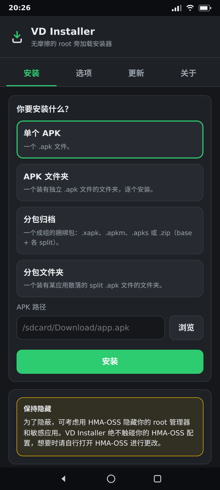
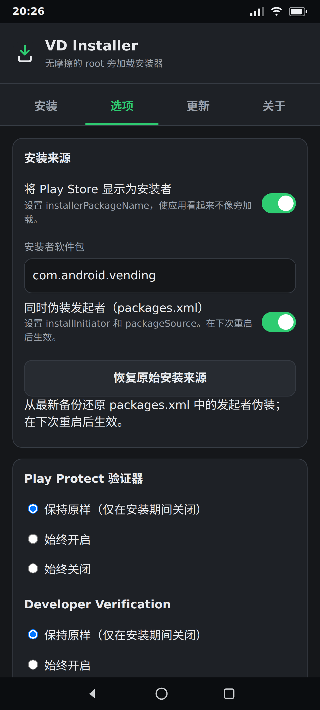
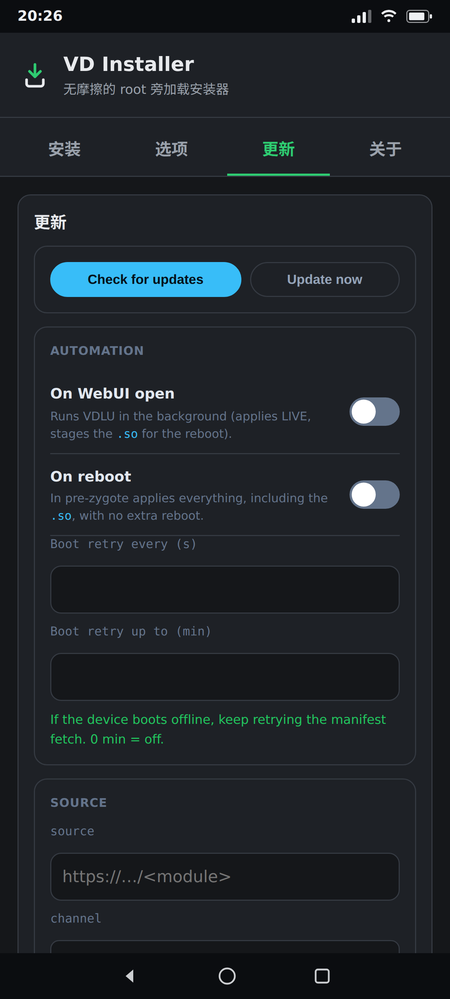
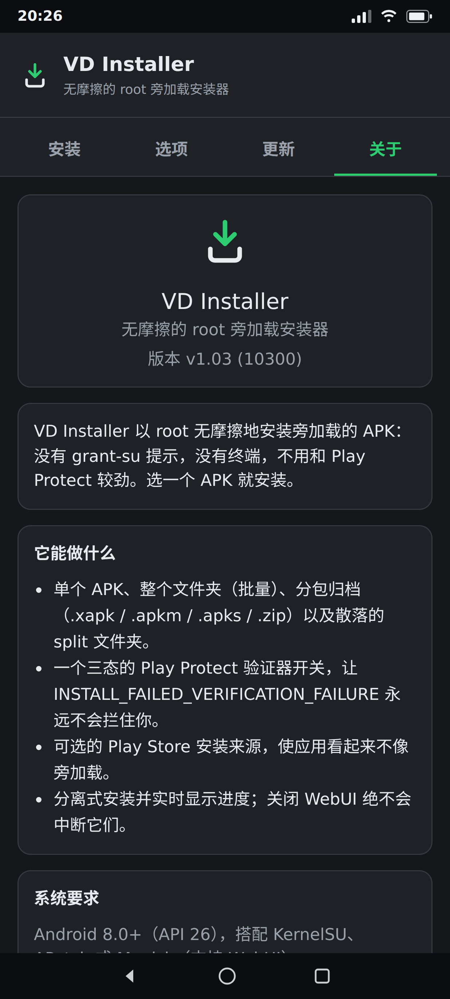

<!--
  ======================================================================
   VD INSTALLER  ::  frictionless root sideload installer
   Install sideload APKs as root (single/batch/split), no friction: KernelSU/APatch/Magisk WebUI.

   Copyright (C) 2026  VD171
   SPDX-License-Identifier: AGPL-3.0-or-later

   Free software under the GNU AGPL v3 or later. NETWORK COPYLEFT: run a
   modified version, even as a service, and you MUST offer its source.

   Site           : https://vd171.ru
   Site           : https://vd.priv8.ru
   Source         : https://github.com/VD171/VD-Installer
   GitHub         : @VD171 https://github.com/VD171
   XDA-Developers : @VD171 https://xdaforums.com/m/vd171.4699873/
   XDA thread     : https://xdaforums.com/t/VD-Installer.4809504/
   Telegram       : @VD_Priv8 https://t.me/VD_Priv8
   Channel        : @Priv8_VD https://t.me/Priv8_VD
   Discord        : @VD.Priv8 https://discord.com/users/1296831918989639721
   E-mail         : vd.priv8@pm.me
  ======================================================================
-->

> **Languages:** [English](README.md) · [العربية](README.ar.md) · [Čeština](README.cs.md) · [Deutsch](README.de.md) · [Español](README.es.md) · [فارسی](README.fa.md) · [Français](README.fr.md) · [हिन्दी](README.hi.md) · [Bahasa Indonesia](README.id.md) · [Italiano](README.it.md) · [日本語](README.ja.md) · [한국어](README.ko.md) · [Nederlands](README.nl.md) · [Polski](README.pl.md) · [Português](README.pt.md) · [Русский](README.ru.md) · [Svenska](README.sv.md) · [ไทย](README.th.md) · [Türkçe](README.tr.md) · [Українська](README.uk.md) · [Tiếng Việt](README.vi.md) · 中文

  

  
  
  
  

  <a href="https://github.com/VD171/VD-Installer/releases">Releases</a> ·
  <a href="https://github.com/VD171/VD-Installer/wiki">Wiki</a> ·
  <a href="https://github.com/VD171/VD-Installer/wiki/USER-GUIDE">用户指南</a> ·
  <a href="https://github.com/VD171/VD-Installer/wiki/AI-AGENTS">AI 代理</a> ·
  <a href="https://github.com/VD171/VD-Installer/wiki/ARCHITECTURE">架构</a> ·
  <a href="https://github.com/VD171/VD-Installer/wiki/FILE-STRUCTURE">文件结构</a> ·
  <a href="https://github.com/VD171/VD-Installer/wiki/BINARIES">二进制文件</a> ·
  <a href="CHANGELOG.md">更新日志</a> ·
  <a href="https://xdaforums.com/t/VD-Installer.4809504/">XDA thread</a>

# VD Installer

> 无摩擦的 root 旁加载安装器: KernelSU / APatch / Magisk WebUI。

## 截图

     

## 为什么

在已 root 的手机上安装一个旁加载的 APK 比它本该有的更吵闹：Play Protect 的软件包验证器可能抛出
`INSTALL_FAILED_VERIFICATION_FAILURE`，分包应用（`.xapk` / `.apkm` / `.apks`）需要手动调用
session API，而刚装好的应用会向每一个读取其安装来源的应用自报为 "sideloaded"。VDInstaller 替你把这些
全部搞定，已经处于 root 状态，没有 "grant su" 提示，也不用终端。

## 特性

- **各种形态的 APK:** 单个 `.apk`、一整个装有独立 APK 的文件夹（批量）、一个成组的分包归档
  （`.xapk` / `.apkm` / `.apks` / `.zip`），或一个装有散落的 split APK 的文件夹。
- **没有验证墙:** 针对 Play Protect 软件包验证器的三态开关：保持原样（仅在安装期间关闭，之后精确恢复）、
  始终开启，或始终关闭。
- **对 Developer Verification 诚实:** 一次 root 安装本就已被豁免于 Android 的 2026 Developer
  Verification；该开关是尽力而为的，并会如实说明，绝非一个假开关。
- **不是 "sideloaded":** 可选地将安装来源呈现为 Play Store，既包括安装者（在安装时），也包括发起者
  （通过一次可识别 ABX 的 `packages.xml` 编辑）。
- **可分离且可续传:** 安装以一个分离的 root 进程运行；关闭 WebUI 绝不会打断它们，界面会按 operation id
  重新连接。
- **由你决定:** 测试包、授予所有运行时权限、目标用户、绕过低目标 SDK 拦截：全部可选。
- **离线、自成一体、无需重启:** 一个自带二进制文件的 WebUI 模块；刷入即可使用。

## AI 代理

本项目欢迎 AI 和代理贡献者。引擎通过一份小巧的无头契约
（`scripts/helper.sh <verb> <base64(JSON)>`）以 JSON 通信，记录于
[docs/AI-AGENTS.md](docs/AI-AGENTS.md)，因此代理可以驱动 WebUI 能做的每一个动作, 请勿抓取 WebUI。
来自 AI 的补丁与其他任何贡献受同样的审查标准约束。

## 安装

在 KernelSU、APatch 或 Magisk 中刷入该 zip，并从你的 root 管理器打开 VDInstaller WebUI。安装器只保留你
设备的 ABI，并运行强制的 `.sha256` 完整性校验闸（在 zip 损坏或被截断时中止）。Android 8.0（API 26）
或更新版本。

## 安全

VDInstaller 以 root 运行并安装你选择的 APK；为某次安装关闭软件包验证器会停用一次恶意软件扫描，所以只安装
你信任的 APK。它绝不会悄悄削弱设备安全：默认情况下验证器会被恢复到其之前的确切状态，而且它绝不触碰你的
HMA-OSS 配置。请按 [SECURITY.md](SECURITY.md) 报告问题。

## 构建

始终 release，绝不 debug。`.github/scripts/build_bin.sh` 从 Termux apt 仓库获取 `jq`（连同其共享库闭包）
以及独立的 `abx2xml` / `xml2abx` 转换器，面向全部四种 ABI，每个都带一份 `PROVENANCE.json`。release
工作流组装可刷入的 zip、写出 `.sha256` 伴随文件、填充 `update.json`，并以 `github-actions[bot]` 的身份
发布。

## 增量更新 (VDLU)

VD Installer 附带 **[VDLiveUpdate](https://github.com/VD171/VDLiveUpdate) (VDLU)** 引擎 (内置于 `module/vdlu/`)：模块只获取已更改的文件 (内容寻址的 blob + 一个带签名的 `manifest.json`) 来自我更新，而不是重新下载整个 `.zip`。**加固**配置：ed25519 签名是强制的，降级被阻止；完整的 `.zip` 仍作为回退保持有效。

- **仅 LIVE** (无需重启)：更新会在下次启动时通过 `service.sh` 在后台应用，当没有可达的 feed 时则为空操作。
- **状态**位于 `/data/adb/vdinstaller/vdlu/`，在模块之外，因此重新刷入后仍然保留。
- **WebUI:** 一个带有进度 toast 和取消的 **更新** 面板；自动更新为可选 (opt-in)。

## 文档

指南位于 [docs/](docs/) 并镜像到 GitHub wiki。关于无头契约，参见
[docs/AI-AGENTS.md](docs/AI-AGENTS.md)。

## 另见

- **[COPG-VD](https://github.com/VD171/COPG-VD)**：设备 fingerprint / Play Integrity 的全局伪装，覆盖整机并支持按应用范围和一个 WebUI。
- **[VDBackup](https://github.com/VD171/VD-Backup)**：以 root 权限完整备份和恢复应用与数据，完全从 WebUI 驱动。
- **[VD-dropbear](https://github.com/VD171/VD-dropbear)**：一个以 root 权限运行的独立 SSH 守护进程（Dropbear）。
- **[VDGoogle](https://github.com/VD171/VD-Google)**：你的 Google 服务（RCS、Wallet、Play Integrity 证明），在你的设备上读取，无需联网。
- **[VDInfos](https://github.com/VD171/VD-Infos)**：一个设备方法调试器，通过每一种能读取某项的方法来读取它，并将它们并排比较。
- **[VDLiveUpdate](https://github.com/VD171/VDLiveUpdate)**：一个无需刷入的增量自更新引擎，嵌入到 KernelSU/APatch/Magisk 模块中。
- **[VD-Modules](https://github.com/VD171/VD-Modules)**：我们的 MMRL/WebUI-X 模块仓库（从你的 root 管理器一次性安装它们全部）。
- **[@VictorGabriel7Dev/build.prop](https://github.com/VictorGabriel7Dev/build.prop)**：一组 Pixel `build.prop` fingerprint 数据集（@T3SL4 的分支）。
- **[@VictorGabriel7Dev/mtproto-store](https://github.com/VictorGabriel7Dev/mtproto-store)**：通过一个小巧的 Go CLI 把 Telegram 当作对象存储使用。

## 联系方式

- https://vd171.ru
- https://vd.priv8.ru
- **Telegram:** @VD_Priv8 https://t.me/VD_Priv8
- **Channel:** @Priv8_VD https://t.me/Priv8_VD
- **Discord:** @VD.Priv8 https://discord.com/users/1296831918989639721
- **E-mail:** vd.priv8@pm.me
- **XDA-Developers:** @VD171 https://xdaforums.com/m/vd171.4699873/
- **XDA thread:** https://xdaforums.com/t/VD-Installer.4809504/
- **GitHub:** @VD171 https://github.com/VD171

## 许可证

VDInstaller 以 GNU AGPL-3.0-or-later 授权。参见 [LICENSE](LICENSE)。NETWORK COPYLEFT：
运行一个修改过的版本，即便是作为服务，你也必须提供其源代码。

## 商标

Android、KernelSU、APatch、Magisk、Google Play 和 Play Protect 归各自所有者所有。
本项目是独立的，不隶属于它们，也未获其认可。

## Tags

`android` `root` `kernelsu` `magisk` `apatch` `webui` `apk-installer` `sideload` `split-apk` `xapk` `vdinstaller`

---

📣 **加入频道以获取更新：** @Priv8_VD https://t.me/Priv8_VD
